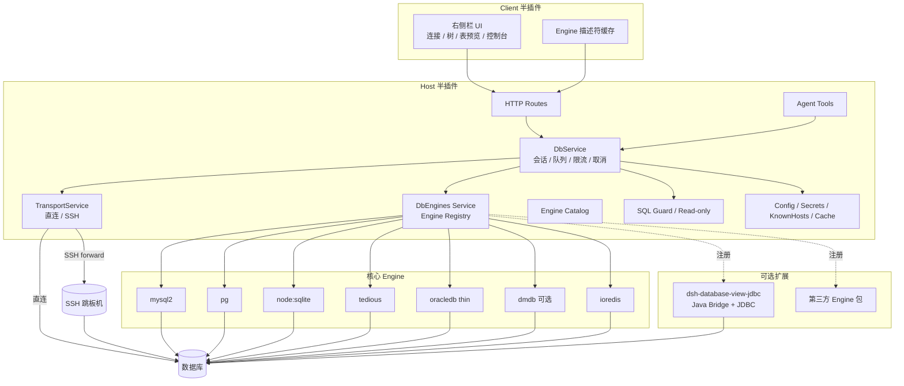
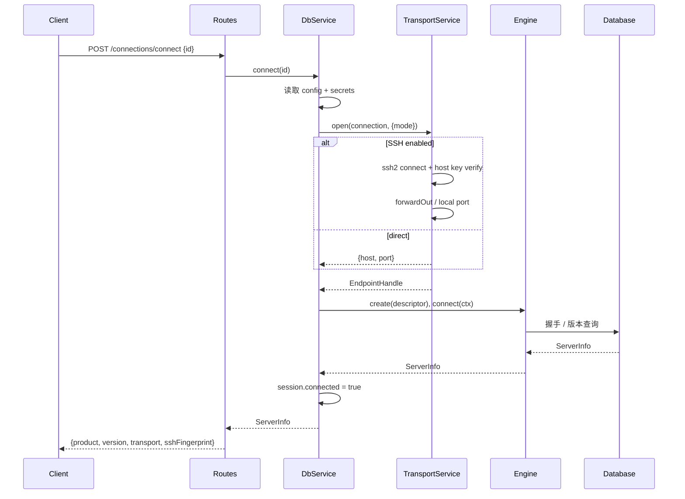
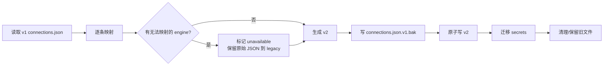
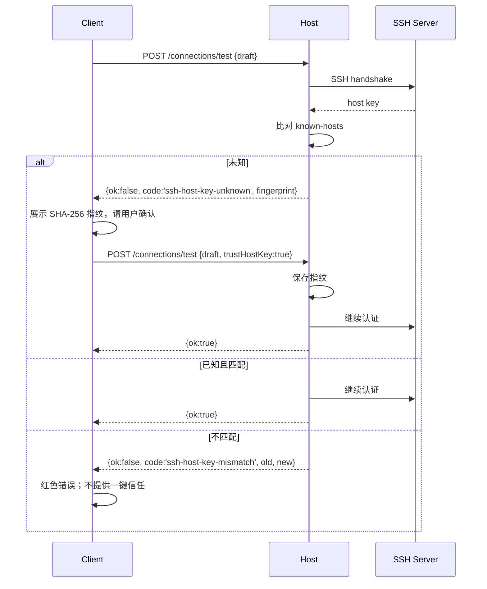

# DSH 数据库表预览插件设计方案（B + 可选 C）

> 版本：v1.1（设计稿，补充统一驱动下载/Driver Pack）  
> 日期：2026-11-14  
> 前置文档：[可行性研究报告](feasibility.md)  
> 范围：Fork `dsh-ide-database`，保留右侧栏 UI，替换为 Java-free 数据访问层；内置 SSH 隧道；JDBC 作为独立可选扩展包（C）。  
> 核心策略：**主流数据库优先，长尾靠 Engine SPI + 可选 JDBC 扩展，不把核心做成 JDBC 的复刻。**

## 目录

- [0. 设计结论](#0-设计结论)
- [1. 范围与数据库优先级](#1-范围与数据库优先级)
- [2. 总体架构](#2-总体架构)
- [3. 数据模型与迁移](#3-数据模型与迁移)
- [4. Engine SPI（扩展性核心）](#4-engine-spi扩展性核心)
  - [4.10 驱动管理（对齐原 JDBC 下载模式）](#410-驱动管理对齐原-jdbc-下载模式)
- [5. 连接与查询服务](#5-连接与查询服务)
- [6. 核心 Engine 设计](#6-核心-engine-设计)
- [7. SSH 隧道](#7-ssh-隧道)
- [8. 可选 C：JDBC 扩展包](#8-可选-cjdbc-扩展包)
- [9. Host API 设计](#9-host-api-设计)
- [10. Client UI 设计](#10-client-ui-设计)
- [11. 构建、打包、安装](#11-构建打包安装)
- [12. 测试与贡献 CI](#12-测试与贡献-ci)
- [13. 里程碑与工作量](#13-里程碑与工作量)
- [14. 风险与开放问题](#14-风险与开放问题)
- [附录 A：文件改动清单](#附录-a文件改动清单)
- [附录 B：关键接口草案](#附录-b关键接口草案)
- [附录 C：API 示例](#附录-capi-示例)

---

## 0. 设计结论

### 0.1 一句话方案

```text
Fork 现有插件
  ├── 保留：右侧栏 UI、HTTP 路由骨架、结构缓存、Agent 工具语义、Redis 面板
  ├── 替换：SqlService → DbService + Engine SPI
  ├── 新增：TransportService（SSH/直连统一入口）
  ├── 新增：Engine Catalog（描述符驱动 UI，外部可注册）
  └── 剥离：Java/JDBC → dsh-database-view-jdbc 可选扩展包
```

### 0.2 关键决策

| # | 决策 | 理由 |
|---|---|---|
| D1 | Fork 现有 MIT 插件，不做从零重写 | 客户端 2.36 万行，重写 UI 成本远大于移植数据访问层 |
| D2 | 核心包不 import 任何 Java 代码 | 默认安装不依赖 JVM；包体积和启动链路更小 |
| D3 | Engine 由 **Descriptor + Factory + Contract Test** 三件套组成 | 新数据库只需加一个目录 + 一行注册，便于外部 PR |
| D4 | UI 由 `/engines` 描述符驱动，不硬编码数据库列表 | 外部 Engine 包无需改核心 UI |
| D5 | SSH 放在 TransportService，不放在 Engine 内 | 所有 Engine（含 JDBC）共享认证、主机密钥、转发逻辑 |
| D6 | JDBC 做成独立包 `dsh-database-view-jdbc`，通过 `dbEngines` 服务注册 | 满足长尾；核心保持 Java-free；可单独安装/卸载 |
| D7 | 主流分 Tier：T1 MySQL/MariaDB/PostgreSQL/SQLite；T2 SQL Server/Oracle/达梦/Redis；T3 OceanBase/JDBC/第三方 | 先覆盖 80% 用户，再扩展 |
| D8 | 保留 `db_*` 工具名，增加 `toolPrefix` 配置与冲突检测 | 降低迁移成本；与旧插件共存时不静默覆盖 |
| D9 | 数据目录用新名字 `dsh-database-view`，提供从旧插件导入 | 避免两个插件互相写坏配置 |
| D10 | 默认只读，写操作显式开启 + 二次确认 + 数据库只读账号建议 | 数据库工具的风险主要在误写/误删 |
| D11 | **统一 DriverManager**：所有 SQL 驱动默认按需下载，JDBC jar 沿用原 Maven 下载模式；另提供可选 offline/bundled 包 | 严格对齐原 JDBC 插件的「缺驱动→下载→缓存→重试」体验；核心包更小，许可/体积可控 |
| D12 | JS 驱动以**自包含 Driver Pack**（esbuild bundle + SHA-256）交付，不在运行时跑 npm/pnpm 安装 | 避免传递依赖解析、构建脚本、版本漂移；离线/审计更可控 |

### 0.3 MVP 与后续

| 范围 | 内容 |
|---|---|
| **MVP（T1）** | MySQL、MariaDB、PostgreSQL、SQLite；SSH（密码/私钥/agent，主机密钥确认）；**统一驱动下载/缓存**；连接管理、树、表预览、DDL、只读 SQL 控制台、结构缓存、只读 Agent 工具 |
| **P2（T2）** | SQL Server、Oracle（Thin）、达梦（许可允许时）、Redis 走 SSH；写操作/事务；TLS 完整适配 |
| **P3（T3）** | OceanBase MySQL、JDBC 扩展包、第三方 Engine 包、多跳 SSH、数据编辑 |

> 工作量在可行性报告的 9–12 人周基础上，增加约 0.5–1 人周用于 SPI、契约测试和贡献文档。

---

## 1. 范围与数据库优先级

### 1.1 主线

先把「主流 + 高频」做扎实：

1. **MySQL 家族**：MySQL 5.7/8.0/8.4、MariaDB 10.x/11.x；OceanBase MySQL 模式复用协议。
2. **PostgreSQL**：12–17。
3. **SQLite**：文件库，桌面/本地分析场景。
4. **SQL Server / Oracle / 达梦**：企业场景，P2。
5. **Redis**：现有插件已有，保留并接入 SSH。

### 1.2 Tier 划分

| Tier | Engine | 驱动交付 | 目标 | 选择理由 | 验收门槛 |
|---|---|---|---|---|---|
| **T1** | MySQL、MariaDB | `download` mysql2（可选 bundled） | MVP | 使用量最大；`mysql2` 成熟；协议/元数据清晰 | 真实实例 + SSH + 中文 + 事务 + 取消 |
| **T1** | PostgreSQL | `download` pg（可选 bundled） | MVP | 使用量第二；`pg` 成熟 | 真实实例 + SSH + `information_schema`/`pg_catalog` |
| **T1** | SQLite | `builtin` node:sqlite | MVP | 无需服务端；`node:sqlite` 内置 | 文件/内存 + 大文本 + `EXPLAIN QUERY PLAN` |
| **T2** | SQL Server | `download` tedious | P2 | 企业常见；`tedious` 纯 JS | 真实实例 + TLS + `SHOWPLAN` |
| **T2** | Oracle | `download` oracledb Thin | P2 | 企业常见；`oracledb` Thin | 真实实例 + `DBMS_METADATA` + `EXPLAIN PLAN` |
| **T2** | 达梦 DM | `user-provided` dmdb / JDBC | P2 | 国内政企常见；`dmdb` 可用但许可受限 | 许可确认 + 真实实例 |
| **T2** | Redis | `dependency` ioredis | P2 | 现有功能；ioredis 纯 JS | SSH + SCAN/取值/命令 |
| **T3** | OceanBase MySQL | `download` mysql2 | P3 | 协议兼容 MySQL；先复用 | 真实租户 |
| **T3** | OceanBase Oracle | `download` JDBC jar | P3 | 协议特殊；JDBC 或实验驱动 | 明确标注实验性 |
| **T3** | 任意 JDBC 库 | `download` JDBC jar | P3 | 长尾 | 安装 `dsh-database-view-jdbc` 后可用 |
| **T3** | 第三方 Engine | 由 Engine 包声明 | P3 | 社区 PR | 通过契约测试 + 安全审查 |

> `bundled` = 随可选 offline 包/手动导入携带的自包含 driver pack，离线可用；`download` = 首次连接时从发布源下载并校验；`builtin` = Node 内置；`user-provided` = 因许可证/体积原因由用户提供文件；`jdbc` 见第 8 章。

### 1.3 非目标

- 不做完整 JetBrains Database 替代（不追求 ER 图、图形化执行计划、数据编辑器、调试器）。
- 核心包不承诺「任意 JDBC 库开箱即用」；这是可选 C 的职责。
- 不做多租户/团队共享连接/云端凭据托管。
- 不在 MVP 做 SSH 多跳、SOCKS、`~/.ssh/config` 全量解析。

### 1.4 设计原则（也是 PR 审核标准）

1. **核心不出现 `if (engine === 'mysql')`**：差异放在 Engine 内部或 Descriptor 的 capability 里。
2. **Engine 只依赖公开接口**：`EngineConnectContext`、`EndpointHandle`、`EngineError`，不 import 核心内部模块。
3. **UI 不硬编码数据库列表**：从 `/engines` 读 Descriptor；新增 Engine 不需要改客户端。
4. **所有 SQL 都经过方言层**：标识符引用、分页、字面量、只读分类集中在 `dialect.ts` / `sql-guard.ts`。
5. **所有结果都有上限**：行数、字节、单元格、超时；Engine 不得返回无界结果。
6. **凭据只进不出**：API 只返回 `hasPassword`/`hasSshPassword`，日志不出现密码/私钥。
7. **可测试**：每个 Engine 提供 Docker fixture + 契约测试；没有测试的 Engine 不合并。
8. **默认安全**：SSH 主机密钥必须确认；TLS 默认校验；只读默认。
9. **可卸载**：Engine/扩展包卸载后，连接配置保留但标记 `unavailable`，不删用户数据。
10. **可上游化**：核心改动尽量小，通用能力（SSH、Engine SPI、契约测试）优先做成可复用模块。

---

## 2. 总体架构

### 2.1 组件图



### 2.2 分层与依赖规则

```text
routes/tools  →  DbService  →  EngineRegistry  →  DatabaseEngine
                     │
                     ├── TransportService → SSH / direct
                     ├── SecretStore / KnownHostsStore
                     ├── StructureCache
                     └── SqlGuard / Limits / ValueCodec
```

规则：

- `routes.ts` 只做参数校验、调用 `DbService`、序列化结果；不直接调用 Engine。
- `DbService` 不 import 具体 Engine；只通过 Registry 创建实例。
- `Engine` 不 import `routes`/`DbService`；只依赖 `EngineConnectContext`、`EndpointHandle`、`EngineError`。
- `TransportService` 不知道 SQL/Engine 细节；只负责「给我一个可达 endpoint」。
- `EngineDescriptor` 是 Host/Client 共享的**可序列化**元数据；`create()` 只存在于 Host 侧。
- 可选 JDBC 包只依赖核心导出的 `./engine` 公共子路径，不 import 核心内部文件。

### 2.3 一次连接的时序



### 2.4 与现有插件的对应关系

| 现有 | 新设计 | 处理 |
|---|---|---|
| `SqlService` + `BridgeClient` | `DbService` + `Engine` | 重写；保留方法语义 |
| JDBC `DriverManager` / `JavaLocator` / `JreManager` | 核心 `dbDrivers` + `dsh-database-view-jdbc` | 下载器上移核心，Java 管理移出 |
| `bridge/` Java | 可选包 | 移出核心 |
| `routes.ts` | 保留骨架 + 新路由 | 改造 |
| `tools.ts` | 保留工具语义 | 改造参数/描述 |
| `structure.ts` / `prefetch.ts` | 保留 | 适配 Engine |
| `redis.ts` | 保留 | 接入 TransportService |
| `client/*` | 保留大部分 | 连接弹窗/设置/错误态改造 |

---

## 3. 数据模型与迁移

### 3.1 `ConnectionConfig` v2

```ts
export type EngineKind = string // 核心内置 + 外部注册；不在核心写死联合类型

export interface ConnectionConfig {
  id: string
  name: string
  engine: EngineKind
  dialect: SqlDialect          // 由 descriptor 派生，缓存用于 SQL/UI
  host: string
  port: number
  database: string
  user: string

  secretName?: string          // DB 密码的 secret ref
  hasPassword: boolean

  ssh?: SshConfig
  tls?: TlsConfig
  options: Record<string, string> // 引擎自定义非敏感选项

  /** 仅 engine === 'jdbc'；核心按 opaque 保留，可选包解析 */
  jdbc?: JdbcOptions

  readOnly: boolean
  createdAt: string
  lastUsedAt?: string
  origin?: 'v1-import' | 'manual'
}
```

客户端版本 `ClientConnection` 不包含 secret，只包含：

```ts
interface ClientConnection extends Omit<ConnectionConfig, 'secretName' | 'hasPassword'> {
  hasPassword: boolean
  hasSshPassword: boolean
  hasSshPassphrase: boolean
}
```

保存/测试草稿：

```ts
export interface ConnectionDraft {
  id?: string
  name: string
  engine: string
  host: string
  port: number
  database: string
  user: string
  password?: string
  clearPassword?: boolean
  ssh?: SshConfig
  sshPassword?: string
  sshPassphrase?: string
  clearSshPassword?: boolean
  tls?: TlsConfig
  options: Record<string, string>
  jdbc?: JdbcOptions
  readOnly: boolean
}
```

- 草稿里的密码字段只在请求体中出现，保存后不返回；
- `sshPassword`/`sshPassphrase` 由 Host 写入 SecretStore，客户端只保留 `has*` 布尔值。

### 3.2 SSH / TLS / JDBC

```ts
export type SshAuth = 'password' | 'key' | 'agent'
export type HostKeyPolicy = 'ask' | 'strict' | 'accept-new'

export interface SshConfig {
  enabled: true
  host: string
  port: number
  user: string
  auth: SshAuth
  privateKeyPath?: string
  hostKeyPolicy: HostKeyPolicy
  connectTimeoutMs?: number
  keepaliveIntervalMs?: number
  keepaliveCount?: number
}

export type TlsMode = 'disable' | 'prefer' | 'require' | 'verify-ca' | 'verify-full'

export interface TlsConfig {
  mode: TlsMode
  caPath?: string
  certPath?: string
  keyPath?: string
  servername?: string       // 隧道场景下用于证书校验的原始主机名
  allowInvalidHostname?: boolean // 默认 false；开启时 UI 必须警告
}

export interface JdbcOptions {
  driverId?: string
  driverClass?: string
  urlTemplate?: string
  jars?: Array<{ group: string; artifact: string; version: string }>
  properties?: Record<string, string>
}
```

**约定**：

- `ConnectionConfig.host/port` 始终是「数据库地址」；SSH 开启时它是**SSH 服务器视角**的地址。
- SSH 服务器地址在 `ssh.host/port`，不与数据库地址混用。
- 密码、SSH 密码、私钥 passphrase 都不在配置文件中；只存 secret ref 或派生 ref。
- `options` 只放非敏感值；JDBC `properties` 里若含密码/令牌，必须走 SecretStore，不能落 `connections.json`。
- `origin: 'v1-import'` 用于迁移提示；不参与运行逻辑。

### 3.3 文件布局

```text
<profile>/data/dsh-database-view/
  connections.json          # v2；不含密码
  ssh-known-hosts.json      # host/port → 指纹
  structure.json            # 结构缓存（v2）
  descriptions/<connId>.ndjson
  secrets.json              # 文件后备；使用 Electron safeStorage 时是密文
  drivers/
    js/*.mjs                 # 下载/导入的 JS driver pack
    jdbc/**/*.jar            # JDBC jar（可选包）
  logs/
  jdbc/                     # 仅安装可选包后出现
    jdbc.json
    jre/
```

数据目录解析优先级沿用现有插件，只改目录名：

1. `DSH_DATABASE_VIEW_DATA`
2. `<DSH_HOME>/profiles/<profile>/data/dsh-database-view`
3. `<DSH_PROFILE_DIR>/data/dsh-database-view`
4. `~/.dsh/data/dsh-database-view`

### 3.4 `connections.json` v2

```jsonc
{
  "version": 2,
  "connections": [ /* ConnectionConfig */ ],
  "trash": [ /* TrashedConnection */ ],
  "settings": {
    "maxRows": 200,
    "maxResultBytes": 8388608,
    "maxCellChars": 400,
    "queryTimeoutSec": 30,
    "connectTimeoutSec": 10,
    "allowAgentWrites": false,
    "confirmDestructive": true,
    "toolPrefix": "db",
    "ssh": {
      "defaultHostKeyPolicy": "ask",
      "knownHostsFile": "ssh-known-hosts.json"
    }
  }
}
```

删除的字段：`drivers`、`javaPath`、`mavenMirror`。它们迁到可选包的 `jdbc/jdbc.json` 或在 v2 中保留为 `legacy`（见 3.5）。

### 3.5 v1 → v2 迁移

| v1 字段 | v2 处理 |
|---|---|
| `driver: mysql/mariadb/postgres/sqlite/mssql/oracle/dameng` | `engine` 同名；`dialect` 由 descriptor 派生 |
| `driver: oceanbase-mysql` | `engine: oceanbase-mysql` |
| `driver: oceanbase-oracle` | `engine: jdbc`，`jdbc` 块保留原 URL/驱动类；可选包未装时 `unavailable` |
| `driver: custom` | `engine: jdbc`，`jdbc` 块由原 `customDriverId` + driver 定义生成 |
| `driver: redis` | `engine: redis` |
| `params` | 核心引擎映射到 `options`；JDBC 连接映射到 `jdbc.properties` |
| `secretName` | 保留；密码值迁移到新 SecretStore |
| `drivers[]` | 写入 `legacyDrivers`（opaque），可选包首次启动时导入 `jdbc/jdbc.json` |
| `javaPath` / `mavenMirror` | 写入 `legacyJdbcSettings`，可选包导入 |
| `readOnly` / `createdAt` / `lastUsedAt` | 保留 |
| `trash[]` | 同样迁移 |

迁移流程：



约束：

- 迁移前备份 `connections.json.v1.bak`；不修改旧插件数据目录。
- 迁移失败时保留 v1 文件，启动进入「只读迁移失败」状态，UI 提供导出/重试。
- 连接 ID 不变，结构缓存可继续使用；若 `dialect` 变化则清空该连接缓存。
- `legacy` 数据不被核心解析，只由可选包读取；核心不因为它的存在而依赖 Java。

### 3.6 从旧插件导入

新插件使用新数据目录，因此默认不会自动读旧数据。提供显式导入：

- `POST /connections/import`：
  - 读取 `<profile>/data/dsh-ide-database/connections.json`（只读）；
  - 返回预览：可导入 N 条、不可导入 M 条、需要 JDBC 扩展 K 条；
  - `commit: true` 时写入 v2，密码从旧 `secrets.json` 复制到新 SecretStore；
  - 不删除、不修改旧目录。
- UI：空状态/设置页「从 dsh-ide-database 导入」。
- 如果用户先卸载旧插件，旧数据目录仍在，可导入。

### 3.7 密钥模型

```ts
export interface SecretRef {
  name: string
  source: 'env' | 'store'
}

export interface SecretProvider {
  get(name: string): Promise<string | undefined>
  set(name: string, value: string): Promise<void>
  delete(name: string): Promise<void>
  has(name: string): Promise<boolean>
}
```

- 首选 `ElectronSafeStorageProvider`：
  - Host 在 Electron main 时用 `safeStorage.encryptString`；
  - 密文写入 `secrets.json`（base64），权限 0600；
  - 启动时检测 `safeStorage.isEncryptionAvailable()`；不可用则回退。
- 后备 `FileSecretProvider`：沿用现有插件格式（base64 + 0600），但明确标注「非加密，仅权限保护」。
- 环境变量覆盖：`DSH_DB_<CONNID>_PASSWORD`、`DSH_DB_<CONNID>_SSH_PASSWORD`、`DSH_DB_<CONNID>_SSH_PASSPHRASE`；优先级高于 store。
- secret 名称：
  - `db/<connId>/password`
  - `db/<connId>/ssh-password`
  - `db/<connId>/ssh-passphrase`
- API 永不返回 secret 值；只返回 `hasPassword` 等布尔值。
- 日志/错误信息统一脱敏；engine 不得把密码拼进异常文本。

### 3.8 结构缓存

- 沿用 `structure.json` + `descriptions/*.ndjson`。
- 缓存键仍是 connection id；新增 `engine`/`dialect` 指纹，迁移/改 engine 时失效。
- 离线可浏览；连接成功后覆盖。
- 表预览、补全元数据从缓存读；不因为 Engine 更换而改变 UI 数据格式。

---

## 4. Engine SPI（扩展性核心）

> 这是本方案最重要的部分。目标是：**新增一个数据库 = 新增一个目录 + 一个注册项 + 一组契约测试**，不修改核心路由、UI、SSH、配置。

### 4.1 `EngineDescriptor`

Host 侧完整描述符：

```ts
export interface EngineDescriptor {
  apiVersion: 1
  kind: string                    // 稳定 id，例如 'mysql'
  label: string                   // UI 显示名
  dialect: SqlDialect             // 引用/分页/字面量方言
  tier: 'core' | 'extended' | 'external'
  order?: number
  defaultPort: number
  hostOptional?: boolean          // SQLite
  fileBased?: boolean             // SQLite
  needsJava?: boolean             // 仅 JDBC 包
  transport: 'tcp' | 'stream'     // 优先传输方式
  driver?: DriverRef              // 驱动包引用；builtin/sqlite 可省略
  capabilities: EngineCapabilities
  form: EngineFormHints
  extraFields?: EngineField[]
  docs?: string
}

export interface DriverRef {
  id: string                      // 对应 drivers.json 的 pack id
  version: string                 // 期望版本；安装版本不匹配时提示更新
  delivery: 'builtin' | 'bundled' | 'download' | 'user-provided'
  license: string
}
```

Client 侧只拿可序列化子集：

```ts
export interface EngineDescriptorInfo {
  kind: string
  label: string
  dialect: SqlDialect
  tier: 'core' | 'extended' | 'external'
  defaultPort: number
  hostOptional?: boolean
  fileBased?: boolean
  needsJava?: boolean
  transport: 'tcp' | 'stream'
  driver?: DriverRef
  capabilities: EngineCapabilities
  form: EngineFormHints
  extraFields?: EngineField[]
  available: boolean
  unavailableReason?: string
  version?: string
}
```

`EngineFormHints`：

```ts
export interface EngineFormHints {
  databaseLabel?: string          // 默认「数据库 / 服务名」
  databaseHint?: string
  userLabel?: string
  passwordLabel?: string
  hostLabel?: string
  showDatabase?: boolean
  showUser?: boolean
  showPassword?: boolean
  showSsh?: boolean               // 文件库可隐藏
  showTls?: boolean
  databaseRequired?: boolean
}
```

`EngineField`（扩展字段）：

```ts
export interface EngineField {
  key: string
  label: string
  type: 'text' | 'number' | 'boolean' | 'select' | 'file'
  required?: boolean
  placeholder?: string
  hint?: string
  default?: string
  options?: Array<{ value: string; label: string }>
}
```

> MVP 只支持非敏感扩展字段；额外密码类字段（如某些 JDBC 属性）在 P2 通过 `secret: true` 扩展，避免核心过早复杂化。

### 4.2 `DatabaseEngine`

```ts
export interface EngineConnectContext {
  connection: Readonly<ConnectionConfig>
  endpoint: EndpointHandle
  credentials: {
    /** DB 密码；SSH 密码/passphrase 由 TransportService 消费，不传给 Engine */
    password: string
  }
  settings: Readonly<EngineSettings>
  drivers: DriverLoader
  log: EngineLogger
}

export interface DriverLoader {
  ensure(id: string): Promise<DriverStatus>
  load<T = unknown>(id: string): Promise<T>
}

export interface DatabaseEngine {
  readonly descriptor: EngineDescriptor

  connect(ctx: EngineConnectContext): Promise<ServerInfo>
  disconnect(): Promise<void>
  ping(): Promise<PingResult>

  listSchemas(filter?: string): Promise<SchemaInfo[]>
  listObjects(schema: string): Promise<SchemaObject[]>
  describe(schema: string, table: string, kind: ObjectKind): Promise<TableDescription>
  ddl(schema: string, table: string, kind: ObjectKind): Promise<DdlResult>

  query(sql: string, options: QueryOptions): Promise<QueryResult>
  explain(sql: string, options?: ExplainOptions): Promise<ExplainResult>
  transaction(action: 'begin' | 'commit' | 'rollback'): Promise<void>
  cancel(stmtKey: string): Promise<boolean>
}
```

约定：

- `connect` 成功后 Engine 持有连接；`disconnect` 必须幂等。
- `query` 必须尊重 `maxRows`、`timeoutMs`、`stmtKey`；超时/取消抛 `EngineError('timeout'|'cancelled')`。
- `describe`/`ddl` 失败时抛 `EngineError`；核心负责回退缓存/生成 DDL。
- 不支持的能力（如 `explain`）抛 `EngineError('unsupported')`；UI 根据 capability 隐藏按钮，不依赖异常。
- Engine 不得直接读 `process.env` 里的密码；只从 `ctx.credentials` 取。
- Engine 不得写配置文件；只通过核心的 `StructureCache`/日志接口（可选）。
- Engine 不得返回超过 `maxResultBytes` 的结果；核心再做一次兜底。

### 4.3 `EngineContribution` / Registry / Service

```ts
export interface EngineContribution {
  apiVersion: 1
  descriptor: EngineDescriptor
  create(): DatabaseEngine
}

export function defineEngine(contribution: EngineContribution): EngineContribution
```

Cordis 服务（核心提供，外部注入）：

```ts
import { Service, type Context, type Disposer } from '@deepseek-ai/cordis'

export class DbEngines extends Service<DbEngines> {
  static readonly apiVersion = 1
  private readonly entries = new Map<string, EngineContribution>()

  constructor(ctx: Context) {
    super(ctx, 'dbEngines')
  }

  register(contribution: EngineContribution): Disposer {
    // 校验 apiVersion、kind 唯一、descriptor 完整
    // 冲突：抛 EngineError('engine-conflict')，不静默覆盖
    this.entries.set(contribution.descriptor.kind, contribution)
    return () => {
      if (this.entries.get(contribution.descriptor.kind) === contribution) {
        this.entries.delete(contribution.descriptor.kind)
      }
    }
  }

  get(kind: string): EngineContribution | undefined
  list(): EngineDescriptorInfo[]
  create(kind: string): DatabaseEngine
}
```

核心插件：

```ts
export const inject = ['webServer', 'tools']

export function apply(ctx: Context, config: Config): void {
  const registry = new DbEngines(ctx)
  for (const contribution of coreEngines) {
    ctx.effect(() => registry.register(contribution))
  }
  // DbService / routes / tools 使用 registry
}
```

外部/可选包：

```ts
export const inject = ['dbEngines']

export function apply(ctx: Context): void {
  ctx.effect(() => ctx.dbEngines.register(jdbcEngineContribution))
}
```

**兼容性**：

- `apiVersion` 不匹配时注册失败，并在插件日志/`/health` 中显示原因；不影响核心其他 Engine。
- 核心只承诺 `EngineDescriptor`/`DatabaseEngine` 的向后兼容；内部文件不承诺。
- 第三方包必须声明 `peerDependencies: { "dsh-database-view": "^0.x" }` 和 `engines.dsh`。

### 4.4 `EngineCapabilities`

```ts
export interface EngineCapabilities {
  schemas: boolean
  multipleDatabases: boolean
  ddl: 'server' | 'generated' | 'none'
  explain: boolean
  transaction: boolean
  cancel: boolean
  readOnlySession: boolean
  streaming: boolean
  tls: 'none' | 'optional' | 'required'
  ssh: boolean
  fileBased: boolean
}
```

UI 只读 capability：

| 能力 | UI 行为 |
|---|---|
| `explain:false` | 隐藏/禁用「执行计划」 |
| `transaction:false` | 隐藏事务按钮 |
| `ddl:'none'` | 隐藏 DDL 按钮 |
| `fileBased:true` | 隐藏 host/port/user/password，显示文件路径 |
| `multipleDatabases:false` | 隐藏库切换，仅显示默认 schema |
| `ssh:false` | 隐藏 SSH 页签 |
| `tls:'none'` | 隐藏 TLS 页签 |

### 4.5 Catalog 与 UI

- `src/host/db/catalog.ts` 汇总核心 Engine：
  ```ts
  import { mysqlEngine } from './engines/mysql/index.js'
  import { postgresEngine } from './engines/postgres/index.js'
  import { sqliteEngine } from './engines/sqlite/index.js'
  // T2...
  export const coreEngines = [mysqlEngine, postgresEngine, sqliteEngine, /* ... */]
  ```
- `DbEngines.list()` 返回 `EngineDescriptorInfo[]`，按 `tier`/`order` 排序。
- `/engines` 或 `/status` 返回列表；Client 缓存并在连接弹窗/设置页使用。
- 新增 Engine 不需要改 Client；只要 `descriptor.form`/`extraFields`/capabilities 描述准确。

### 4.6 契约测试（Testkit）

核心导出 `./testkit`：

```ts
export interface EngineContractOptions {
  create(): DatabaseEngine
  connection: ConnectionConfig
  credentials: { password: string }
  /** 有写权限的测试库；只读测试可省略 */
  writable?: boolean
  cleanup?: () => Promise<void>
}

export function defineEngineContractTests(options: EngineContractOptions): void
```

覆盖：

- `connect` / `disconnect` / 重复 disconnect
- `listSchemas` / `listObjects`（表、视图）
- `describe`（列、主键、索引）
- `ddl`（服务端或生成）
- `query`（SELECT、NULL、中文、数字、日期）
- `maxRows` 截断、字节上限
- `explain`（若 capability 支持）
- `transaction`（若支持）
- `cancel`/timeout（若支持）
- 只读连接拒绝写
- 错误映射（认证失败/网络失败/语法错误）

外部 Engine 的 CI 可以只跑契约测试 + 自己的 Docker fixture；核心 CI 跑 T1/T2。

### 4.7 新增 Engine 的步骤（贡献者文档）

```text
src/host/db/engines/<kind>/
  index.ts          // export const <kind>Engine = defineEngine({...})
  descriptor.ts     // label/defaultPort/capabilities/form
  engine.ts         // implements DatabaseEngine
  metadata.ts       // schemas/objects/describe/ddl/explain SQL
  codec.ts          // 值类型转换
  README.md         // 支持版本/限制/测试方法
  *.test.ts         // 契约测试入口
```

步骤：

1. 复制 `engines/_template/`，填 descriptor。
2. 实现 `connect/query`，先跑通 `SELECT 1`。
3. 移植 metadata/DDL/explain（可参考 Java `SqlExecutor` 或现有方言）。
4. 加 Docker fixture（`tests/fixtures/<kind>.ts`）和契约测试。
5. 在 `catalog.ts` 加一行注册。
6. 如需外部驱动：在 `drivers.json` 注册 manifest，或让用户手动导入；不要在 Engine 里直接 `import 'pkg'`。
7. 更新 `docs/engines/<kind>.md`：支持版本、已知限制、TLS/SSH/驱动交付说明。
8. 提交 PR，附测试输出。

**PR 审核清单**：

- [ ] 没有修改核心路由/UI 逻辑（只加 catalog 注册 + 测试/文档）。
- [ ] 没有 `if (kind === ...)` 泄漏到核心。
- [ ] 所有查询有行数/字节上限；没有无界结果。
- [ ] 只读连接不会执行写语句；写能力有 capability 声明。
- [ ] 密码/私钥不进入日志、错误、配置。
- [ ] 有真实实例集成测试（或明确标注仅单元测试）。
- [ ] 许可证允许分发（尤其达梦/Oracle 驱动）。
- [ ] 驱动 pack 有 SHA-256/版本/许可证；运行时从 DriverManager 加载。
- [ ] 不引入原生模块；如必须，附跨平台验证。

### 4.8 第三方 Engine 包示例

```ts
// dsh-database-view-clickhouse/src/index.ts
import { defineEngine, type DatabaseEngine } from 'dsh-database-view/engine'

export const inject = ['dbEngines']

export function apply(ctx) {
  ctx.effect(() =>
    ctx.dbEngines.register(
      defineEngine({
        apiVersion: 1,
        descriptor: {
          apiVersion: 1,
          kind: 'clickhouse',
          label: 'ClickHouse',
          dialect: 'generic',
          tier: 'external',
          defaultPort: 8123,
          transport: 'tcp',
          driver: {
            id: 'clickhouse-js',
            version: '1.0.0',
            delivery: 'download',
            license: 'Apache-2.0',
          },
          capabilities: { /* ... */ },
          form: { databaseLabel: 'Database' },
        },
        create: () => new ClickHouseEngine(),
      }),
    ),
  )
}
```

如果第三方 Engine 需要自己的驱动包：

1. 在包里实现 `DriverArtifact`，通过 `ctx.dbDrivers.register()` 注册；
2. 或让用户手动导入（`delivery: 'user-provided'`）；
3. 不要 import 核心内部文件，只使用 `dsh-database-view/engine` 和 `dsh-database-view/drivers` 公共子路径。

> 实现时 `defineEngine` 只接收一份 `create`；上面的重复写法在实现时合并。

### 4.9 长尾策略

按优先级：

1. **能进核心的**：协议稳定、用户多、无许可/原生模块问题 → 放核心 `engines/`。
2. **不进核心但可维护的**：放独立 npm 包，通过 `dbEngines` 注册；核心 README 列出社区 Engine。
3. **任意 JDBC**：安装 `dsh-database-view-jdbc`，用 JDBC 描述符 + Maven jar；不要求写 Engine。
4. **临时/内部库**：用户可以自己写一个本地 DSH bundle，注册 Engine；文档提供模板。

这样核心不会被长尾拖慢，社区也有明确 PR 路径。

### 4.10 驱动管理（对齐原 JDBC 下载模式）

> 用户明确要求：所需驱动参考原 JDBC 插件的「缺驱动 → 下载 → 缓存 → 重试」模式。  
> 本节把「JS 驱动包」和「JDBC jar」统一到同一个 DriverManager / manifest / UI / 工具。

#### 4.10.1 目标体验

1. 用户新建 SQL Server 连接，点击「测试连接」。
2. 插件发现 `tedious` 驱动未安装，返回 `driver-missing`，并给出：驱动名、版本、大小、许可证、下载按钮。
3. 用户点击「下载驱动」→ 下载、SHA-256 校验、写入缓存 → 自动重试连接。
4. 之后离线可用；设置页可查看已安装驱动、更新、删除、手动导入。
5. JDBC 连接同理，只是驱动是 Maven jar；达梦因许可证走「用户提供文件」模式。

#### 4.10.2 交付模式

| 模式 | 含义 | 例子 | 网络 |
|---|---|---|---|
| `builtin` | 运行时/Node 内置，无需下载 | SQLite 的 `node:sqlite` | 无 |
| `bundled` | 随可选 offline 包/手动导入携带的自包含 `.mjs`，首次使用即可用 | offline 包里的 mysql2、pg、tedious 等；Redis 的 ioredis 作为核心 dependency | 无 |
| `download` | 核心只带 manifest，首次使用时从发布源下载 | mysql2、pg、tedious、oracledb Thin（默认） | 需要 |
| `user-provided` | 因许可/体积/合规原因，由用户提供文件 | dmdb（达梦） | 无（用户自备） |
| `jdbc` | JDBC jar 从 Maven 下载，沿用原逻辑 | MySQL/PG/Oracle/DM JDBC | 需要 |

**为什么默认用 download：**

- 严格对齐原 JDBC 插件：首次使用某引擎时才下载对应驱动，装完插件不背所有驱动；
- 核心 npm 包更小，许可证/体积/平台差异留在下载阶段处理；
- T1 驱动只有几百 KB，下载成本低；失败时可以重试/换镜像/手动导入；
- 企业/离线环境可以导入可选的 **offline 驱动包**（zip：`drivers/*.mjs` + `drivers.json`），或在设置页手动导入单个驱动；
- 所有模式共用同一套状态、UI、校验、缓存，用户感知一致。

> 如果产品决定「T1 开箱即用」，把 manifest 的 `delivery` 从 `download` 改成 `bundled` 并随包携带 `drivers/*.mjs` 即可，代码路径不变。

#### 4.10.3 Manifest

核心包携带 `drivers.json`（只读，随版本发布）：

```jsonc
{
  "version": 1,
  "packs": [
    {
      "id": "mysql2",
      "engine": "mysql",
      "kind": "js",
      "version": "3.24.6",
      "delivery": "download",
      "urls": [
        "https://github.com/<org>/dsh-database-view/releases/download/drivers-v1/mysql2-3.24.6.mjs"
      ],
      "sha256": "…",
      "bytes": 412345,
      "license": "MIT"
    },
    {
      "id": "tedious",
      "engine": "mssql",
      "kind": "js",
      "version": "20.3.9",
      "delivery": "download",
      "urls": [
        "https://github.com/<org>/dsh-database-view/releases/download/drivers-v1/tedious-20.3.9.mjs",
        "https://cdn.jsdelivr.net/gh/<org>/dsh-database-view@drivers-v1/drivers/tedious-20.3.9.mjs"
      ],
      "sha256": "…",
      "bytes": 612345,
      "license": "MIT"
    },
    {
      "id": "oracledb-thin",
      "engine": "oracle",
      "kind": "js",
      "version": "6.10.0",
      "delivery": "download",
      "urls": ["…"],
      "sha256": "…",
      "bytes": 987654,
      "license": "Apache-2.0 OR UPL-1.0"
    },
    {
      "id": "dmdb",
      "engine": "dameng",
      "kind": "js",
      "version": "1.0.52452",
      "delivery": "user-provided",
      "license": "Commercial",
      "instructions": "达梦驱动为商业许可，请从达梦官方获取 dmdb 包后在此导入。"
    }
  ]
}
```

JDBC 扩展包额外提供 `drivers.jdbc.json`（或向 `dbDrivers` 注册 artifact），结构类似，但 `kind: "jdbc"`、`maven` 坐标、SHA-1/SHA-256。

#### 4.10.4 DriverManager

```ts
export interface DriverArtifact {
  id: string
  engine: string
  kind: 'js' | 'jdbc'
  version: string
  delivery: 'builtin' | 'bundled' | 'download' | 'user-provided' | 'jdbc'
  license: string
  sha256?: string
  bytes?: number
  file?: string          // bundled 相对路径
  urls?: string[]        // download
  maven?: { group: string; artifact: string; version: string; classifier?: string }
  instructions?: string
}

export interface DriverStatus {
  id: string
  engine: string
  version: string
  delivery: DriverArtifact['delivery']
  license: string
  installed: boolean
  source?: 'builtin' | 'bundled' | 'download' | 'imported'
  path?: string
  bytes?: number
  sha256?: string
  downloadAvailable: boolean
  updateAvailable?: boolean
  error?: string
}

export class DbDrivers extends Service<DbDrivers> {
  static readonly apiVersion = 1

  list(): DriverStatus[]
  status(id: string): DriverStatus
  register(artifact: DriverArtifact): Disposer

  /** 确保可用；缺失时抛 DriverMissingError（带可下载信息） */
  async ensure(id: string): Promise<DriverStatus>

  /** 下载并校验；成功后可被 ensure 使用 */
  async download(id: string, options?: { signal?: AbortSignal }): Promise<DriverStatus>

  /** 用户手动导入（dmdb / 离线包 / 企业内部分发） */
  async import(id: string, filePath: string): Promise<DriverStatus>

  async remove(id: string): Promise<void>
}
```

- 核心提供 `dbDrivers` 服务；JDBC 扩展包 `inject: ['dbDrivers']` 并注册自己的 artifacts。
- `status` 必须实际检查文件存在/大小/哈希，不能只看 manifest；内置/下载/导入文件缺失或损坏时 `installed:false` 并给出 `error`。
- `ensure` 在 `DbService.connect` 之前调用；缺失时返回可操作的 `driver-missing`，而不是让 Engine 抛 `MODULE_NOT_FOUND`。
- 已加载的 driver module 按 `id@version+sha` 缓存；下载新版本后需重连/重启 Engine。

#### 4.10.5 加载、下载、导入

**加载**：

```ts
const file = status.source === 'bundled'
  ? join(dataDir, 'drivers', 'offline', artifact.file ?? `${id}-${version}.mjs`)
  : join(dataDir, 'drivers', 'js', `${id}-${version}.mjs`)
const mod = await import(pathToFileURL(file).href + `?sha=${artifact.sha256}`)
```

- 只从 `<data>/drivers/offline/`（离线包）或 `<data>/drivers/js/`（下载/导入）加载；不从 workspace、`node_modules` 或用户任意路径自动发现。
- 单文件 pack 直接 `import()`；目录包读取 `package.json.main`/`index.js` 后 `import()`；依赖必须已随目录提供，不在运行时解析 npm 依赖。
- 加载前校验 SHA-256（下载/导入）；包内文件随 npm 完整性校验。
- 校验导出：`mysql2` 必须有 `createConnection`，`pg` 必须有 `Client`，`tedious` 必须有 `Connection`；缺失则 `driver-invalid`。
- 缓存 module；版本变更后使用新 URL/查询参数避免 ESM 缓存旧模块。

**下载**：

- `fetch` + `AbortSignal.timeout(120s)`；跟随重定向；限制最大字节（如 50 MB）。
- 校验 HTTP 状态、`content-length`（若提供）、SHA-256；不匹配则删除临时文件。
- 原子写：`<file>.tmp-<pid>` → rename；目录 0700，文件 0600。
- 多 URL 顺序重试；镜像可配置；失败信息包含 URL、HTTP 状态、校验结果。
- 代理：尊重 `HTTPS_PROXY`/`HTTP_PROXY`（Node 24 可用 `NODE_USE_ENV_PROXY=1`）；企业内网镜像走 manifest 的 URL。
- 不做「运行时 npm/pnpm install」；避免传递依赖、构建脚本、lockfile 漂移。

**手动导入**：

- `POST /drivers/import {id, path}`；路径由用户在系统文件选择器中选择（或手填）。
- 支持三种形态：
  1. 单文件 `.mjs`/`.cjs`（自包含 pack）；
  2. 单文件 `.tgz`/`.tar.gz`（解压到 `<data>/drivers/js/<id>-<version>/`，拒绝路径穿越）；
  3. npm 包目录（含 `index.js`/`package.json` 及其依赖），复制到 `<data>/drivers/js/<id>-<version>/`。
- 校验：manifest 提供 SHA-256 时必须匹配；目录导入至少校验入口文件与大小，并在 UI 明确「这是可执行代码」。
- `dmdb` 的 `user-provided` 模式：导入 npm 包目录或 tgz 后状态为 `imported`；加载入口 `package.json.main`/`index.js`；许可证由用户自行确认。
- JDBC jar 导入同理，交给 JDBC 扩展包加载；jar 只作为 Java classpath，不在 Node 中执行。

**删除/更新**：

- 删除只删缓存文件，不动连接配置；下次连接重新提示下载。
- 更新：manifest 版本高于已安装时显示 `updateAvailable`；用户确认后下载新文件，成功后切换；旧版本保留一份用于回滚（P2）。

#### 4.10.6 Driver Pack 构建

```text
driver-packs/
  mysql2/entry.ts       // export * from 'mysql2/promise'
  pg/entry.ts           // export * from 'pg'
  tedious/entry.ts      // export * from 'tedious'
  oracledb/entry.ts     // export * from 'oracledb'
scripts/build-drivers.mjs
```

```ts
await esbuild.build({
  entryPoints: ['driver-packs/mysql2/entry.ts'],
  bundle: true,
  platform: 'node',
  format: 'esm',
  target: ['node22'],
  external: ['node:*'],
  outfile: 'dist/drivers/mysql2-3.24.6.mjs',
  legalComments: 'none',
})
```

- 产物是**自包含 ESM**，包含所有传递依赖；不依赖 profile 的 `node_modules`。
- 生成后计算 SHA-256/字节数，写入 `drivers.json`。
- CI 发布到 GitHub Release / CDN；核心 npm 包默认只包含 `drivers.json` manifest，可选 offline 包才包含 `drivers/*.mjs`。
- `oracledb` 需要特殊处理：Thin 模式纯 JS，但包内有 thick 模式原生二进制与动态 `require`；构建时 external/alias 掉 `.node`，只保留 Thin；M0 必须先做 spike 验证。
- `ssh2` 不作为 driver pack：它是核心 SSH 功能依赖，随核心安装。
- `ioredis` 是 Redis 核心功能依赖：作为核心 `dependencies` 安装，保持开箱即用（不强制下载）。

**如果某个驱动无法安全 bundle：**

1. 优先退回「核心 dependency」（仍 Java-free，只是安装体积大）；
2. 或在 manifest 中标 `user-provided`，让用户自备；
3. 最后才考虑运行时安装 npm 包（需要 pnpm/npm，非默认）。

#### 4.10.7 Engine 集成

`EngineDescriptor.driver` 指向 manifest：

```ts
driver: {
  id: 'tedious',
  version: '20.3.9',
  delivery: 'download',
  license: 'MIT',
}
```

Engine 的加载方式：

```ts
const tedious = await ctx.drivers.load<typeof import('tedious')>('tedious')
```

- TypeScript 类型用 `import type`/`typeof import(...)`，编译期有类型；运行期从 driver pack 加载。
- Engine 不直接 `import 'mysql2'`；否则会被打包进核心，失去按需下载。
- Engine 的 `connect` 前由 `DbService` 调 `ensure(driver.id)`；Engine 内也可防御性调用。
- `descriptor.available` 由 DriverManager 状态决定；缺失时 `unavailableReason: 'driver-missing'`。

#### 4.10.8 路由、工具、UI

新增/统一路由：

| 路由 | 作用 |
|---|---|
| `POST /drivers/list` | 列出驱动状态（安装/缺失/可更新/许可证/大小） |
| `POST /drivers/download` | 下载并校验；返回新状态 |
| `POST /drivers/import` | 手动导入（路径） |
| `POST /drivers/remove` | 删除缓存 |
| `POST /drivers/check-updates` | 对比 manifest 版本 |

- `db_download_driver` Agent 工具保留，参数从 `driverId` 扩展为 manifest id；只允许下载 manifest 中存在的驱动。
- 连接测试/连接失败返回 `driver-missing`，并带 `driver: DriverStatus`，前端直接渲染下载按钮。
- 设置页新增「驱动」：
  - 已安装/可用/缺失分组；
  - 每项显示版本、许可证、大小、来源（内置/下载/导入）；
  - 下载/更新/删除/导入；下载中进度/取消；
  - 「驱动来源」说明：内置、发布源、Maven、用户提供。
- 连接弹窗引擎下拉：缺驱动的引擎仍可选，但测试时提示下载；或置灰并显示「需下载驱动」。
- JDBC 扩展包复用同一「驱动」页，增加 Maven 镜像/Java 设置。

#### 4.10.9 安全、许可、离线

- **只从 manifest URL 下载**；客户端不能传任意 URL；手动导入需用户显式选择文件并警告。
- **校验强制**：下载必须 SHA-256 匹配；JDBC jar 至少校验 Maven `.sha1`（沿用原逻辑），优先 SHA-256。
- **许可证展示**：每个驱动显示 license；达梦为 `Commercial`，必须走用户提供；不打包、不托管。
- **离线**：bundled/builtin 可用；download 驱动可手动导入；JDBC jar 可手动放入缓存目录（校验后）。
- **代理/镜像**：支持环境代理与企业镜像；manifest 可配置多 URL。
- **供应链**：固定版本 + checksum + lockfile；构建产物可复现；发布源使用 HTTPS。
- **不执行任意远程代码**：只加载校验通过的 driver pack；用户导入的代码由用户承担风险，UI 明确提示。

#### 4.10.10 失败与降级

| 场景 | 行为 |
|---|---|
| 驱动未安装 | `driver-missing` + 下载按钮；连接不建立 |
| 下载失败 | 保留旧状态；显示 URL/HTTP/校验错误；可重试/换镜像 |
| 校验失败 | 删除临时文件；不加载；提示可能的镜像/网络问题 |
| 版本不匹配 | 提示更新；允许继续用旧版本（若 API 兼容）或强制更新 |
| 驱动加载失败 | `driver-invalid`；回退到上一个可用版本（P2）或提示重装 |
| 用户取消下载 | 保持缺失状态；不影响其他连接 |
| 离线且未安装 | 提示手动导入/使用 offline 驱动包 |
| DM 许可 | 不提供下载 URL；只提供「导入 dmdb 文件」+ 许可说明 |

#### 4.10.11 与原 JDBC 下载模式对照

| 能力 | 原 JDBC 插件 | 新方案 |
|---|---|---|
| 驱动元数据 | 内置 Maven 坐标 | `drivers.json` manifest |
| 下载源 | Maven Central / 阿里云 | 发布源/CDN + Maven（JDBC） |
| 校验 | `.sha1`（存在时） | SHA-256（强制）；JDBC 兼容 `.sha1` |
| 缓存 | `drivers/*.jar` | `drivers/js/*.mjs`、`drivers/jdbc/**/*.jar` |
| 缺失提示 | 连接时提示下载 | `driver-missing` + 下载对话框 |
| 手动导入 | 放入 jar 目录 | 单文件/目录/tgz/离线 zip |
| 自定义驱动 | 驱动类/URL/Maven 坐标 | JDBC 扩展包同原逻辑 |
| Agent 工具 | `db_download_driver` | 同名，支持所有 manifest id |
| 设置页 | 驱动下载/Java/Maven | 统一「驱动」页 + JDBC 扩展页 |
| 离线 | 手动放 jar | offline 驱动包/手动导入 |

---

## 5. 连接与查询服务

### 5.1 `TransportService`

```ts
export type TransportMode = 'direct' | 'ssh-stream' | 'ssh-tcp'

export interface EndpointHandle {
  mode: TransportMode
  host: string
  port: number
  stream?: Duplex
  close(): Promise<void>
  onLost(listener: (error: Error) => void): Disposer
}

export class TransportService {
  open(connection: ConnectionConfig, options: { preferStream: boolean }): Promise<EndpointHandle>
  close(connectionId: string): Promise<void>
  closeAll(): Promise<void>
}
```

职责：

- 直连：返回 `{mode:'direct', host, port}`。
- SSH：
  - 认证、主机密钥校验、known_hosts；
  - `preferStream=true` 且驱动支持 → `forwardOut` 返回 stream；
  - 否则起本地 `net.Server`，返回 `{mode:'ssh-tcp', host:'127.0.0.1', port}`。
- 生命周期：一个连接一个 handle；关闭时销毁 stream/server/SSH client。
- 掉线：通知所有 listener；`DbService` 标记 session degraded，关闭 Engine 连接。
- 不做 SQL/Engine 相关逻辑。

### 5.2 `ConnectionSession`

```ts
export type SessionState = 'disconnected' | 'connecting' | 'connected' | 'degraded' | 'error'

export class ConnectionSession {
  readonly id: string
  state: SessionState
  lastError?: string
  server?: ServerInfo
  transportMode?: TransportMode
  sshFingerprint?: string

  connect(): Promise<ServerInfo>
  disconnect(): Promise<void>
  reconnect(): Promise<ServerInfo>
  run<T>(task: (engine: DatabaseEngine) => Promise<T>): Promise<T>
  cancel(stmtKey: string): Promise<boolean>
}
```

- 一个 session 一个 Engine 实例；MVP 串行执行（`run` 内部队列）。
- 元数据/表预览/Agent 查询共享同一队列；prefetch 用低优先级队列项。
- 断开时：取消队列、关闭 engine、关闭 transport、清空 active statements。
- `degraded`：SSH 掉线/网络断；保留 `server` 与结构缓存供离线浏览；重连按钮。
- 事务进行中：禁止切换连接/关闭标签页；关闭时回滚（沿用现有行为）。

### 5.3 `DbService`

```ts
export class DbService {
  connect(id: string): Promise<ServerInfo>
  disconnect(id: string): Promise<void>
  test(draft: ConnectionDraft): Promise<ConnectionTestResult>
  query(id: string, sql: string, options: QueryOptions): Promise<QueryResult>
  schemas/objects/describe/ddl/explain/transaction/cancel...
  status(): { sessions: SessionStatus[] }
  dispose(): Promise<void>
}
```

- 连接配置读取、secret 解析、**驱动 ensure**、transport 打开、Engine 创建都在这里编排。
- 连接前先解析 `EngineDescriptor.driver` 并调用 `ctx.dbDrivers.ensure(id)`；缺失时抛 `driver-missing`，附带 `DriverStatus`，不打开 SSH/网络。
- 会话 map：`Map<connectionId, ConnectionSession>`；重复 connect 幂等。
- 连接失败：关闭 transport，返回 `DbError`；不缓存半初始化 session。
- 并发限制：全局 `maxConcurrentQueries`（默认 8）+ 每 session 1；超出排队。
- 超时：`queryTimeoutSec`；`Promise.race` + engine.cancel；超时后 session 标记可用（除非驱动不支持取消，则断开）。
- 审计：记录 `connectionId, engine, sqlKind, elapsed, rows, errorCode`，不记录 SQL 全文（可配置）。

### 5.4 结果规范化与类型映射

所有 Engine 必须返回现有的 `QueryResult`：

```ts
interface QueryResult {
  columns: ColumnInfo[]   // name, typeName, nullable
  rows: CellValue[][]     // string | number | boolean | null
  rowCount: number
  truncated: boolean
  updateCount?: number
  elapsedMs: number
  warnings: string[]
  sql: string
  stmtKey?: string
}
```

统一规则：

| 类型 | 内部/线上 | 说明 |
|---|---|---|
| 整数 ≤ 2^53 | number | JS 安全整数 |
| BIGINT / DECIMAL / NUMBER | string | 保精度；不要转 number |
| DATE / DATETIME / TIMESTAMP | string | 数据库原字面值；禁止 Date→JSON 时区偏移 |
| TIME / INTERVAL | string | 原字面值 |
| BOOLEAN | boolean | 驱动返回布尔时保留 |
| BLOB / BYTEA / VARBINARY | string | `0x...` 或 base64，带截断标记；不在 JSON 里放 Buffer |
| JSON / JSONB | string | 原样文本；UI 可格式化 |
| NULL | null | 与空字符串区分 |
| 长文本 | string | 单元格最多 `maxCellChars`，完整值有上限 |

Engine 负责把驱动类型转成上表；核心 `normalizeResult` 再做：

- 行数截断（`maxRows`）；
- 字节上限（`maxResultBytes`）；
- 单元格截断（`maxCellChars`）；
- 列名去重/空名 fallback；
- `elapsedMs`/`truncated`/`warnings` 补齐。

**方言差异**：

- MySQL：`charset: 'utf8mb4'`、`dateStrings: true`、`supportBigNumbers/bigNumberStrings`；`DATETIME` 不能转 JS Date。
- PostgreSQL：自定义 `types.setTypeParser` 返回字符串（date/timestamp/numeric/json）；数组转文本。
- SQLite：`node:sqlite` 返回 `Uint8Array` 时转 hex；数值列注意 `BigInt`。
- SQL Server：`tedious` 日期/十进制转字符串；`rowCollectionOnRequestCompletion`。
- Oracle：`fetchAsString` 对 DATE/TIMESTAMP/CLOB/NUMBER；LOB 读入上限。
- 达梦：按 `dmdb` 类型映射，P2 实测。

### 5.5 表预览 SQL

- 方言分页：
  - MySQL/MariaDB/PostgreSQL/SQLite/OceanBase MySQL：`LIMIT ? OFFSET ?`
  - SQL Server：`ORDER BY ... OFFSET ? ROWS FETCH NEXT ? ROWS ONLY`；无排序时补主键/`(SELECT NULL)`。
  - Oracle 12c+：`OFFSET ? ROWS FETCH NEXT ? ROWS ONLY`；老版本 `ROWNUM`。
  - 达梦：`LIMIT ? OFFSET ?`（实测确认）。
- 标识符：来自结构缓存/元数据白名单；`quoteIdent(dialect, name)`。
- 值：优先参数绑定；不支持绑定的位置用 driver `escape`/`quoteLiteral`。
- 不默认 `COUNT(*)`；用「多取一行」判断下一页；总数按钮显式触发，超时降级为「未知」。
- 大字段：先 `LEFT/SUBSTR` 截断，或按主键单独取完整值；单页字节上限。

---

## 6. 核心 Engine 设计

### 6.0 驱动交付一览

| Engine | driver id | 交付 | 版本策略 | 说明 |
|---|---|---|---|---|
| MySQL/MariaDB/OceanBase MySQL | `mysql2` | download（可选 bundled） | 固定 + 可更新 | 默认按需下载；offline 包可内置 |
| PostgreSQL | `pg` | download（可选 bundled） | 固定 + 可更新 | 默认按需下载；offline 包可内置 |
| SQLite | `node:sqlite` | builtin | Node/Electron 内置 | 无 driver pack |
| SQL Server | `tedious` | download | 固定 + 可更新 | 首次使用下载 |
| Oracle | `oracledb-thin` | download | 固定 + 可更新 | Thin 模式；需 spike 验证 bundle |
| 达梦 | `dmdb` | user-provided | 用户自备 | 商业许可；不托管 |
| Redis | `ioredis` | dependency | 固定 | 随核心 dependency，开箱即用 |
| JDBC | `jdbc-*` | download | Maven 坐标 | 可选包提供 |

### 6.1 MySQL / MariaDB / OceanBase MySQL

**文件**：`engines/mysql/{index,descriptor,engine,metadata,codec}.ts`

**连接**：

```ts
mysql.createConnection({
  host, port, user, password, database,
  charset: 'utf8mb4',
  dateStrings: true,
  supportBigNumbers: true,
  bigNumberStrings: true,
  multipleStatements: false,
  connectTimeout,
  ssl,          // 由 TlsConfig 映射
  stream,       // SSH stream 模式
  host: tlsServername ?? host, // stream 模式下保留原 host 用于 SNI
})
```

**能力**：`schemas:true`（库=Schema）、`ddl:'server'`、`explain:true`、`transaction:true`、`cancel:true`、`readOnlySession:true`、`tls:'optional'`、`transport:'stream'`。

**元数据**：

- schemas：`information_schema.schemata` 或 `SHOW DATABASES`；系统库过滤。
- objects：`information_schema.tables` + `routines` + `triggers`。
- columns：`information_schema.columns`（`COLUMN_TYPE`、`COLUMN_KEY`、`EXTRA`、`COLUMN_COMMENT`）。
- indexes：`information_schema.statistics`。
- DDL：`SHOW CREATE TABLE/VIEW/FUNCTION/PROCEDURE/TRIGGER`。
- explain：`EXPLAIN <sql>`；结果转文本/表格。

**只读**：`SET SESSION TRANSACTION READ ONLY`（MySQL 5.7+；MariaDB 对应语法需测试）；Host guard 仍生效。

**取消**：优先用独立管理连接 `KILL QUERY <threadId>`；失败则 `connection.destroy()` 并重建 session。

**坑**：

- `DATETIME` 时区偏移（必须 `dateStrings`）。
- `utf8mb4` 必须显式设置；否则中文/emoji 异常。
- `caching_sha2_password` 需要 TLS 或 `allowPublicKeyRetrieval`；默认不要关闭 TLS 校验。
- 多语句默认关闭；控制台拆语句执行。

### 6.2 PostgreSQL

**文件**：`engines/postgres/*`

**连接**：

```ts
new pg.Client({
  host, port, user, password, database,
  application_name: 'dsh-database-view',
  statement_timeout: queryTimeoutMs,
  query_timeout: queryTimeoutMs,
  ssl, // { ca, cert, key, rejectUnauthorized, checkServerIdentity? }
})
```

**能力**：`schemas:true`、`ddl:'generated'`（表无内置 `pg_get_tabledef`）、`explain:true`、`transaction:true`、`cancel:true`、`readOnlySession:true`、`tls:'optional'`、`transport:'tcp'`。

**元数据**：

- schemas：`pg_namespace` / `information_schema.schemata`。
- objects：`information_schema.tables` + `pg_class`/`pg_proc` + 序列/触发器。
- columns：`information_schema.columns` + `pg_catalog` 类型/默认值/注释。
- indexes：`pg_indexes` / `pg_index`。
- DDL：视图 `pg_get_viewdef`、触发器 `pg_get_triggerdef`、序列拼 `CREATE SEQUENCE`；表按结构生成并标注 `generated`。
- explain：`EXPLAIN (FORMAT TEXT) <sql>`。

**只读**：`SET default_transaction_read_only = on` 或 `SET SESSION CHARACTERISTICS AS TRANSACTION READ ONLY`。

**取消**：用独立连接执行 `SELECT pg_cancel_backend($1)`；连接中断时 `client.end()`。

**坑**：

- `pg` 不接受裸 ssh2 channel（`setNoDelay`），必须本地端口转发。
- TLS 穿隧道：本地端口时用 `ssl.checkServerIdentity` 对原主机名校验证。
- `timestamptz` 保留原字面值/时区，不要默认转 UTC ISO 后丢时区。
- 数组/JSON 解析：显式 type parser，避免 `[object Object]`。

### 6.3 SQLite

**文件**：`engines/sqlite/*`

**连接**：

```ts
import { DatabaseSync } from 'node:sqlite'
const db = new DatabaseSync(path, { readOnly })
db.exec('PRAGMA busy_timeout = 5000')
if (readOnly) db.exec('PRAGMA query_only = ON')
```

**能力**：`schemas:false`（单库）、`ddl:'server'`（`sqlite_master.sql`）、`explain:true`（`EXPLAIN QUERY PLAN`）、`transaction:true`、`cancel:false`（MVP，worker 终止为 P2）、`readOnlySession:true`、`tls:'none'`、`ssh:false`、`fileBased:true`。

**元数据**：

- objects：`sqlite_master`（table/view/trigger/index）。
- columns：`PRAGMA table_info`；主键、默认值、notnull。
- indexes：`PRAGMA index_list` + `index_info`。
- DDL：`sqlite_master.sql`；没有时按结构生成。
- explain：`EXPLAIN QUERY PLAN`。

**执行模型**：

- `node:sqlite` 是同步 API；大查询会阻塞 Host 事件循环。
- MVP：所有 SQLite 查询放到 `worker_threads` worker；主线程只做消息传递/超时/终止。
- 只读连接用 `PRAGMA query_only=ON`；写连接需显式 `readOnly:false` + Agent 写开关。
- `:memory:` 每个连接独立；不支持跨连接共享。
- Web 形态 Node <22.13：检测 `node:sqlite`，不可用时回退 `sql.js`（WASM），并在能力里标注。

### 6.4 SQL Server（P2）

**文件**：`engines/mssql/*`

**连接**：

```ts
new tedious.Connection({
  server: host,
  authentication: { type: 'default', options: { userName, password } },
  options: {
    port,
    database,
    encrypt: tls?.mode !== 'disable',
    trustServerCertificate: tls?.allowInvalidHostname === true,
    serverName: tls?.servername ?? host,
    rowCollectionOnRequestCompletion: true,
    connectTimeout,
    requestTimeout,
  },
})
```

**能力**：`schemas:true`（schema）、`ddl:'generated'`（`OBJECT_DEFINITION` 可用时 `server`）、`explain:true`（`SHOWPLAN_ALL`）、`transaction:true`、`cancel:true`、`readOnlySession:false`（依赖只读账号 + Host guard）、`tls:'optional'`、`transport:'tcp'`。

**元数据**：`sys.objects/columns/indexes/types`、`OBJECT_DEFINITION`、`sys.sequences`；explain 用 `SET SHOWPLAN_ALL ON` + 查询 + `OFF`（只编译不执行）。

**坑**：

- TLS 穿隧道用 `options.serverName` 保留原主机名。
- 默认加密协商；自签证书需显式信任，不能默认 `trustServerCertificate:true`。
- 取消 `request.cancel()`；连接失败要区分登录失败/网络/TLS。

### 6.5 Oracle（P2）

**文件**：`engines/oracle/*`

**连接**：

```ts
oracledb.getConnection({
  user, password,
  connectString: `${host}:${port}/${service}`, // Easy Connect
  // 或 tnsnames/descriptor
})
oracledb.fetchAsString = [oracledb.DATE, oracledb.TIMESTAMP, oracledb.NUMBER, oracledb.CLOB]
```

**能力**：`schemas:true`（用户/Schema）、`ddl:'server'`（`DBMS_METADATA.GET_DDL`）、`explain:true`（`EXPLAIN PLAN FOR` + `DBMS_XPLAN.DISPLAY`）、`transaction:true`、`cancel:true`（`connection.break()`）、`readOnlySession:true`（`SET TRANSACTION READ ONLY`）、`tls:'optional'`、`transport:'tcp'`。

**元数据**：`all_tables`、`all_objects`、`all_tab_columns`、`all_indexes`、`all_constraints`、`all_tab_comments`、`all_col_comments`。

**坑**：

- Thin 模式要求 Oracle 12.1+；Thick 模式不启用。
- `DBMS_METADATA.GET_DDL` 返回 CLOB；按上限读取。
- `NUMBER` 精度；`DATE`/`TIMESTAMP` 用字符串。
- TCPS/钱包/证书穿隧道需实测；默认 `ssl_server_dn_match` 行为要在 Engine 文档写清。
- `V$VERSION` 可能无权限；用 `product_component_version` 兜底。

### 6.6 达梦（P2）

**文件**：`engines/dameng/*`

**连接**：`dmdb.getConnection({ host, port, user, password, database? })`（具体 API 以 DM 文档为准）。

**能力**：`schemas:true`、`ddl:'server'`（`DBMS_METADATA` 或达梦对应包）、`explain:true`（`EXPLAIN`/驱动 API，待实测）、`transaction:true`、`cancel:false`（待实测）、`readOnlySession:true`（若支持）、`tls:'optional'`、`transport:'tcp'`。

**元数据**：Oracle 风格 `ALL_TABLES/ALL_OBJECTS/ALL_TAB_COLUMNS/ALL_INDEXES`；达梦兼容视图需实测。

**许可与交付**：

- driver id `dmdb`，`delivery:'user-provided'`；用户在「设置 → 驱动」导入官方包（目录/tgz），或走 JDBC 扩展。
- `dmdb` 是商业许可，**核心包不打包、不托管下载**。
- 首版不默认安装；设置页提供「达梦支持需要用户自行安装 dmdb 并接受许可」说明。
- 或者达梦连接走可选 JDBC 包（达梦 JDBC 驱动从 Maven 获取）。
- 具体策略见开放问题 Q3。

### 6.7 Redis

**文件**：`engines/redis/*` 或保留 `host/redis.ts`

- 保留现有 `ioredis` 实现：SCAN、类型、TTL、值面板、命令。
- 连接地址通过 `TransportService`（SSH 时本地端口）。
- TLS：`ioredis` 的 `tls.servername` 保留原主机名。
- 不实现 `DatabaseEngine`；`EngineDescriptor` 标记 `dialect:'redis'`，UI 走 Redis 专用面板。
- 只读/危险命令白名单沿用现有逻辑。

### 6.8 Engine 文件模板

```text
engines/<kind>/
  index.ts        // defineEngine + export
  descriptor.ts   // label/defaultPort/tier/capabilities/form
  engine.ts       // connect/query/transaction/cancel
  metadata.ts     // 元数据 SQL 与结果映射
  codec.ts        // 类型转换
  errors.ts       // 错误码映射（可选）
  README.md       // 支持版本/限制/测试
  engine.test.ts  // 契约测试
```

要求：

- `metadata.ts` 只返回共享类型；不 import routes/client。
- `codec.ts` 不依赖 Engine 连接对象；纯函数，便于单测。
- 每个 Engine 的 SQL 都参数化/转义；不拼未验证的标识符。
- 每个 Engine 在 README 写清「不支持什么」，避免用户误解。

---

## 7. SSH 隧道

### 7.1 配置与认证

```ts
interface SshConfig {
  enabled: true
  host: string
  port: number
  user: string
  auth: 'password' | 'key' | 'agent'
  privateKeyPath?: string
  hostKeyPolicy: 'ask' | 'strict' | 'accept-new'
  connectTimeoutMs?: number
  keepaliveIntervalMs?: number
  keepaliveCount?: number
}
```

认证：

- `password`：secret `db/<id>/ssh-password`。
- `key`：读取 `privateKeyPath`（支持 `~`），passphrase 可选（secret `db/<id>/ssh-passphrase`）；用 `ssh2.utils.parseKey` 校验。
- `agent`：`SSH_AUTH_SOCK`；Windows agent 作为 P2。
- keyboard-interactive：密码认证失败时尝试一次；UI 不单独暴露。

### 7.2 主机密钥

默认策略：`ask`。

流程：



- `strict`：未知也拒绝；适合高级用户。
- `accept-new`：未知自动保存（不推荐默认；只给高级开关）。
- `mismatch`：始终拒绝；提供「查看指纹/手动删除 known-host」入口。
- known-hosts 文件：`ssh-known-hosts.json`，记录 `{host, port, keyType, fingerprint, firstSeenAt, lastSeenAt}`。
- 指纹算法：SHA-256 base64（与 OpenSSH `SHA256:...` 一致）。

### 7.3 转发模式

| 模式 | 实现 | 适用 | TLS |
|---|---|---|---|
| `direct` | 直接 host/port | 无 SSH | 正常 |
| `ssh-stream` | `forwardOut` 返回 Duplex，交给驱动 | `mysql2` | host 保留原值，SNI 正常 |
| `ssh-tcp` | 本地 `net.Server` + `forwardOut` | `pg`、`tedious`、`oracledb`、`dmdb`、Redis、JDBC | 用 servername/checkServerIdentity 适配 |

**本地端口 server**：

- 绑定 `127.0.0.1:0`；每个连接 `forwardOut(local.remoteAddress, local.remotePort, targetHost, targetPort)`。
- 只接受 loopback；随机端口；连接关闭时销毁 socket。
- 同一 SSH client 可服务多个本地连接（连接池）。
- 空闲超时（如 5 分钟）关闭 server，下次按需重建。

### 7.4 生命周期与重连

- `TransportService.open` 幂等：同一 connection id 已有 handle 则复用。
- SSH client `keepaliveInterval/Count`；`readyTimeout`。
- `error`/`close` 事件：
  - 标记 handle `lost`；
  - 关闭本地 server/所有 stream；
  - 通知 `DbService` → session `degraded`；
  - 拒绝在途查询（`EngineError('transport-lost')`）。
- 重连：用户点「重连」或下一次操作；关闭旧 Engine，重新 open + connect。
- 不在后台无限重试；避免把生产库打满。

### 7.5 错误码与 UX

| 场景 | code | UI |
|---|---|---|
| SSH 密码/私钥错误 | `ssh-auth-failed` | 高亮认证字段 |
| 主机密钥未知 | `ssh-host-key-unknown` | 指纹确认对话框 |
| 主机密钥变化 | `ssh-host-key-mismatch` | 红色错误；查看/删除 known-host |
| sshd 禁止转发 | `ssh-forwarding-denied` | 提示检查 `AllowTcpForwarding` |
| 网络不可达/超时 | `ssh-network` / `ssh-timeout` | 重试/检查地址 |
| 私钥格式/passphrase 错误 | `ssh-key-invalid` | 提示路径/口令 |
| 本地端口绑定失败 | `ssh-local-bind-failed` | 重试/检查本机端口 |
| TLS 校验失败 | `tls-verify-failed` | 显示证书主机名/颁发者；提供 CA/关闭校验（需确认） |

### 7.6 安全边界与限制

- 默认不提供 `insecure` 主机密钥模式；`accept-new` 需高级设置。
- 本地端口只绑 loopback；同机进程仍可能连接（单用户桌面风险可接受；多用户主机需说明）。
- 不转发 agent（`agentForward` 关闭）。
- 不支持 SSH 多跳/SOCKS（P3）；支持时用 `sock` 链式连接。
- 私钥不复制到插件数据目录；只存路径。
- 不在日志输出 SSH 握手包、密码、passphrase。

---

## 8. 可选 C：JDBC 扩展包

### 8.1 边界

- 包名：`dsh-database-view-jdbc`。
- 目标：覆盖任意 JDBC 数据库、OceanBase Oracle 模式、以及无法用 Node 驱动的长尾。
- 不进入核心依赖；不安装时核心完全 Java-free。
- 复用现有 Java bridge 代码（MIT）；Java/JRE 管理迁移到独立包，JDBC jar 下载器上移到核心 `dbDrivers`。
- JDBC jar 的下载/校验/缓存/状态/UI 统一走核心的 `dbDrivers`（`kind:'jdbc'`），不再单独维护一套下载器。
- 许可：达梦 JDBC 驱动仍按达梦许可；不默认打包，用户确认后下载。

### 8.2 包结构

```text
dsh-database-view-jdbc/
  package.json          // dsh.bundle.patch + dsh.client?（可选）
  cordis.patch.yml
  lib/
    index.js            // Host: 注册 jdbc engine
    client.js           // 可选：JDBC 设置面板
  bridge/
    dsh-db-bridge.jar
    src/...
  src/
    engine.ts           // JdbcEngine implements DatabaseEngine
    artifacts.ts        // 向 dbDrivers 注册 Maven jar artifacts
    java.ts / jre.ts
    bridge.ts
    settings.ts
    routes.ts           // /jdbc/*（Java/JRE/镜像设置）
  locale/...
```

### 8.3 服务注册

```ts
// dsh-database-view-jdbc/src/index.ts
import { defineEngine } from 'dsh-database-view/engine'
import { JdbcEngine } from './engine.js'

export const inject = ['dbEngines', 'dbDrivers']

export function apply(ctx) {
  // 1) 把 JDBC jar 注册进统一 DriverManager
  ctx.effect(() => ctx.dbDrivers.register(jdbcArtifacts))
  // 2) 注册 JDBC engine
  ctx.effect(() =>
    ctx.dbEngines.register(
      defineEngine({
        apiVersion: 1,
        descriptor: {
          apiVersion: 1,
          kind: 'jdbc',
          label: 'JDBC（扩展）',
          dialect: 'generic',
          tier: 'external',
          defaultPort: 0,
          needsJava: true,
          transport: 'tcp',
          capabilities: { /* schemas, ddl, explain, transaction, cancel, tls, ssh */ },
          form: { databaseLabel: '数据库 / Service' },
        },
        create: () => new JdbcEngine(),
      }),
    ),
  )
}
```

> 实现时 `defineEngine` 只接收一份 `create`；这里为了展示 descriptor 与 factory 分离，保留两份伪代码。

核心的 `TransportService` 对 `transport:'tcp'` 一律给本地端口；JDBC 驱动连 `127.0.0.1:<port>`，TLS 主机名通过 `JdbcOptions.sslHostname` 或驱动属性处理。

### 8.4 数据与设置

- 数据目录：`<core>/jdbc/`（与核心共享 profile data，但独立子目录）。
- `jdbc.json`：Java 路径、Maven 镜像、JRE 信息、自定义驱动定义。
- JDBC jar 缓存：`<core>/drivers/jdbc/`，由核心 `dbDrivers` 管理。
- `jre/`：可选 JRE 下载/内置。
- 设置页：Java 路径、JRE 下载、Maven 镜像、自定义驱动、默认参数。
- 核心设置页不显示 Java 相关内容；只有注册了 `jdbc` descriptor 时才显示「JDBC 扩展」入口。

### 8.5 与核心的 API

- 核心给 JDBC 包：
  - `dbEngines` 服务（注册 Engine）；
  - `dbDrivers` 服务（注册/下载/加载 jar artifact）；
  - `EngineConnectContext`（endpoint/credentials/settings）；
  - 公共类型/错误/日志。
- JDBC 包给核心：
  - `jdbc` descriptor + `JdbcEngine`；
  - 向 `dbDrivers` 注册 Maven artifacts（坐标/镜像/许可/校验）；
  - `/jdbc/*` HTTP 路由（Java/JRE/镜像设置）；
  - 可选客户端设置面板。
- 核心不感知 Java 类路径、jar、JRE；只感知 `needsJava:true` 和 `available`。

### 8.6 启用/卸载/迁移

- 安装后重启 DSH；`jdbc` 出现在引擎列表。
- 卸载后：
  - 已有 `engine:'jdbc'` 连接保留，标记 `unavailable`；
  - UI 显示「安装 JDBC 扩展包后可用」；
  - 不删除连接/结构缓存/用户数据。
- 从旧插件迁移：
  - v1 的 custom 驱动/`oceanbase-oracle` 连接写入 `jdbc` 块；
  - JDBC 包首次启动导入 `legacyDrivers`/`legacyJdbcSettings`；
  - 未安装包时这些连接不可用，但配置不丢。

### 8.7 长尾策略

1. **JDBC 包**覆盖「任意 JDBC」；不需要为每个库写 Engine。
2. **外部 Engine 包**覆盖「JDBC 不合适的协议」（如 HTTP/原生协议）。
3. 核心 README 维护「已知 Engine 包」列表；审核标准见 4.7。
4. 不把长尾 Engine 塞进核心；避免依赖/许可/测试矩阵膨胀。

### 8.8 JDBC jar 下载（复用原模式）

JDBC 包注册 artifacts 示例：

```ts
export const jdbcArtifacts: DriverArtifact[] = [
  {
    id: 'jdbc-mysql',
    engine: 'jdbc',
    kind: 'jdbc',
    version: '8.4.0',
    delivery: 'jdbc',
    license: 'GPLv2 with FOSS exception',
    maven: { group: 'com.mysql', artifact: 'mysql-connector-j', version: '8.4.0' },
    sha256: '…',
  },
  {
    id: 'jdbc-oracle',
    engine: 'jdbc',
    kind: 'jdbc',
    version: '23.26.3.0.0',
    delivery: 'jdbc',
    license: 'Oracle Free Use Terms',
    maven: { group: 'com.oracle.database.jdbc', artifact: 'ojdbc8', version: '23.26.3.0.0' },
    sha256: '…',
  },
]
```

流程：

1. 用户选择 JDBC 驱动 / 预设；连接测试发现 jar 缺失。
2. `dbDrivers.download('jdbc-mysql')`：
   - 从 Maven Central / 阿里云镜像下载；
   - 校验 `.sha1`（存在时）或 manifest 的 SHA-256；
   - 缓存到 `<data>/drivers/jdbc/<group>/<artifact>/<version>/<file>.jar`；
   - 状态写入 `/drivers/list`。
3. JDBC Engine 从 `DriverStatus.path` 组装 classpath，启动 Java bridge。
4. 支持手动导入 jar、删除、更新；UI 与 JS driver pack 同一个「驱动」页。
5. 自定义 Maven 坐标仍走「自定义驱动」表单；下载/校验逻辑复用 `dbDrivers`。

与旧插件的差异：

- 下载器从 JDBC 包上移到核心 `dbDrivers`，JS/JDBC 共用；
- jar 缓存路径统一到 `<data>/drivers/jdbc/`；
- 仍支持 Maven Central / 阿里云镜像；
- 仍显示 jar 名称、版本、大小、校验状态、许可证；
- 失败信息保留 URL/HTTP/校验细节。

---

## 9. Host API 设计

### 9.1 路由清单

保留现有路径，减少客户端改动：

| 路由 | 变更 |
|---|---|
| `POST /status` | 返回 v2 config + engines + drivers + env + prefetch；不再返回 Java 状态（除非 JDBC 包扩展） |
| `POST /engines` | **新增**：EngineDescriptorInfo 列表 |
| `POST /env` | 返回平台/数据目录/引擎版本；JDBC 包可扩展 |
| `POST /connections/save` | 接收 v2 draft；含 ssh/tls/options |
| `POST /connections/delete/restore/purge/trash/empty/reorder` | 不变 |
| `POST /connections/test` | 接收 v2 draft；返回 SSH 指纹/信任需求 |
| `POST /connections/connect/disconnect` | 不变；返回 `transportMode`/`sshFingerprint` |
| `POST /connections/prefetch` | 不变 |
| `POST /connections/import` | **新增**：从旧插件导入 |
| `POST /ssh/probe` | **新增**：只测 SSH/指纹 |
| `POST /ssh/trust` | **新增**：保存主机指纹 |
| `POST /ssh/known-hosts` | **新增**：列出/删除 known-host |
| `POST /structure` | 不变 |
| `POST /schema/list/objects/describe/ddl` | 不变 |
| `POST /explain` | 不变；capability 控制 |
| `POST /query` | 不变；新增 `maxBytes` 可选 |
| `POST /query/cancel` | 不变 |
| `POST /tx` | 不变 |
| `POST /redis/*` | 不变；transport 走 SSH |
| `POST /settings/update` | 扩展 v2 设置 |
| `POST /health` | 扩展 sessions/engines/drivers |
| `POST /drivers/list` | **新增**：驱动状态（JS pack + JDBC jar） |
| `POST /drivers/download` | **新增**：下载/校验驱动 |
| `POST /drivers/import` | **新增**：手动导入驱动文件/目录 |
| `POST /drivers/import-bundle` | **新增**：导入离线驱动包 zip |
| `POST /drivers/remove` | **新增**：删除驱动缓存 |
| `POST /drivers/check-updates` | **新增**：检查驱动更新 |
| `/java/*` | 移出核心；JDBC 包提供 `/jdbc/java/*` |

### 9.2 关键类型

```ts
interface EngineDescriptorInfo {
  kind: string
  label: string
  dialect: SqlDialect
  tier: 'core' | 'extended' | 'external'
  defaultPort: number
  hostOptional?: boolean
  fileBased?: boolean
  needsJava?: boolean
  transport: 'tcp' | 'stream'
  driver?: DriverRef
  capabilities: EngineCapabilities
  form: EngineFormHints
  extraFields?: EngineField[]
  available: boolean
  unavailableReason?: string
  version?: string
}

interface ConnectionTestResult {
  ok: boolean
  latencyMs: number
  message?: string
  server?: ServerInfo
  transport?: 'direct' | 'ssh'
  ssh?: {
    host: string
    port: number
    keyType: string
    fingerprint: string
    known: boolean
    changed: boolean
  }
  needsHostKeyTrust?: boolean
  driver?: DriverStatus
  note?: string
  code?: string
}

interface SshProbeResult {
  ok: boolean
  latencyMs: number
  banner?: string
  hostKey?: { keyType: string; fingerprint: string; known: boolean; changed: boolean }
  message?: string
}
```

### 9.3 错误码

| code | HTTP | 含义 |
|---|---|---|
| `invalid` | 400 | 参数/草稿不合法 |
| `auth-failed` | 401 | 数据库认证失败 |
| `read-only` | 403 | 只读连接拒绝写 |
| `not-found` | 404 | 连接/对象不存在 |
| `engine-not-available` | 409 | Engine 未注册/扩展包未装 |
| `driver-missing` | 409 | 所需驱动未安装；附 DriverStatus/下载信息 |
| `driver-download-failed` | 502 | 驱动下载失败（网络/HTTP） |
| `driver-checksum-failed` | 422 | 驱动校验失败 |
| `driver-invalid` | 500 | 驱动无法加载/缺少预期导出 |
| `ssh-host-key-unknown` | 409 | 需要用户确认指纹 |
| `ssh-host-key-mismatch` | 409 | 指纹变化，拒绝 |
| `ssh-auth-failed` | 401 | SSH 认证失败 |
| `ssh-forwarding-denied` | 422 | sshd 禁止转发 |
| `ssh-network` | 502 | SSH 网络错误 |
| `tls-verify-failed` | 422 | 证书/主机名校验失败 |
| `unsupported` | 422 | 能力不支持 |
| `timeout` | 504 | 超时 |
| `cancelled` | 499 | 用户取消 |
| `limit-exceeded` | 413 | 结果/请求过大 |
| `query-failed` | 500 | SQL/驱动错误 |
| `jdbc-pack-missing` | 409 | 需要安装 JDBC 包 |

保持 `{ ok:false, error:{code,message,detail} }` 信封。

### 9.4 鉴权/限流

- 沿用现有 `ctx.get('connection')?.requestRejection()`；无该服务时做 Origin/`sec-fetch-site` 检查。
- 所有变更 POST；`content-type: application/json`；body 上限 4 MB。
- 不返回密码/私钥/passphrase；`/health` 只返回计数/版本。
- 每连接串行队列 + 全局并发限制；超出返回 `limit-exceeded` 或排队。
- 失败登录/SSH 不做无限重试；记录次数用于提示。

### 9.5 兼容性

- 客户端与 Host 同包发布，API 可随版本变；但保留 `/query`、`/schema/*` 等旧路径，减少 UI 改动。
- `EngineDescriptor.apiVersion` 是外部包的唯一稳定契约；核心内部 API 不承诺。
- `ConnectionConfig` v2 是持久化契约；新增字段必须可选、可回退。

---

## 10. Client UI 设计

### 10.1 信息架构

```text
右侧栏
  ├── 数据库面板
  │     ├── 工具栏：新建 / 刷新 / 删除 / 控制台 / 回收站 / 设置
  │     ├── 数据源树：连接 → Schema → 表/视图/例程 → 列/键/索引
  │     └── 详情：列/索引/DDL
  ├── 数据表标签页（每表一个）
  │     ├── WHERE / ORDER BY / 刷新 / 导出 / DDL
  │     └── 网格：分页、排序、列筛选、长文本弹层
  └── SQL 控制台标签页
        ├── 数据源 / Schema 选择
        ├── 编辑器 / 执行 / 取消 / 历史 / 格式化
        └── 结果网格 / 执行计划 / 事务
```

### 10.2 连接弹窗

```text
┌──────────────────────────────────────────────┐
│ 新建数据源连接                          [×]  │
├──────────────────────────────────────────────┤
│ [常规] [SSH] [TLS] [高级]                    │
│                                              │
│ 名称   [________________________]            │
│ 引擎   [MySQL                     ▼]         │
│ 主机   [___________] 端口 [____]             │
│ 用户   [___________]                         │
│ 密码   [___________]                         │
│ 数据库 [___________]                         │
│ [ ] 只读连接（面板与 Agent 均拒绝写）        │
│                                              │
│ [测试连接]                      [保存]        │
└──────────────────────────────────────────────┘
```

- 引擎下拉按 `tier` 分组：核心 / 扩展 / 第三方；`available:false` 置灰并显示原因。
- `fileBased`（SQLite）：隐藏 host/port/user/password，显示文件路径。
- SSH 页签：
  - 开关、主机/端口/用户、认证方式、私钥路径/passphrase、agent；
  - 主机密钥策略；「测试 SSH」；指纹状态（未知/已信任/已变化）。
- TLS 页签：
  - 模式、CA/证书/私钥路径、servername、允许无效主机名（警告）。
- 高级页签：
  - `options` 键值；引擎 `extraFields`；连接超时；
  - JDBC 扩展字段（仅 `needsJava` 或 `jdbc` descriptor）。
- 测试结果：
  - 成功：产品/版本/延迟/传输方式/指纹；
  - 失败：按错误码给可操作提示；主机密钥未知弹确认；
  - `driver-missing`：显示驱动名/版本/大小/许可证 + 「下载并重试」；下载完成自动重试。
- 引擎下拉每项旁显示驱动状态（内置/已安装/需下载）；缺驱动的引擎仍可选，保存后在连接时提示下载。

### 10.3 数据源树

- 连接节点显示 engine label、`SSH` 徽标、只读徽标、连接状态。
- 未连接但有缓存：灰色/「离线」标记，可浏览结构；双击表提示先连接。
- 右键菜单：连接/断开、编辑、复制、回收站、刷新结构。
- 搜索/筛选沿用现有实现；不依赖 Engine 细节。

### 10.4 表预览

- 顶部：`schema.table`、只读/SSH 徽标、DDL、刷新、导出。
- WHERE/ORDER BY：列名提示来自结构缓存；参数化/转义。
- 分页：100/200/500/1000；「下一页」用多取一行判断；总数可选。
- 网格：沿用现有虚拟滚动、列宽/列序、单元格弹层、右键复制。
- 空态/错误态：区分「没有数据」「没有匹配」「连接断开」「表不存在」。
- 大文本/二进制：单元格截断，弹层显示完整值（有上限）；二进制显示 hex 预览。

### 10.5 控制台

- 沿用现有编辑器、历史、补全、格式化、多语句、取消。
- `explain` 按钮按 capability 显示；不支持的 Engine 隐藏。
- 事务按钮按 capability 显示；只读连接禁用。
- 方言函数/关键字按 `dialect` 取，不再按 `driver` 取。
- 结果网格与导出沿用；SQL 方言引用从 `dialect.ts` 取。

### 10.6 设置

```text
设置
  ├── 连接：最大行数、字节上限、超时、默认只读、确认破坏性操作
  ├── SSH：默认主机密钥策略、known-hosts 列表（host/指纹/最后使用/删除）
  ├── 驱动：已安装/可下载/需导入；版本、许可证、大小、来源；下载/更新/删除/导入
  ├── 引擎：已注册 Engine、版本、可用性、能力；「如何新增 Engine」链接
  ├── 外观/快捷键：沿用
  └── 扩展（仅安装 JDBC 包时）：Java 路径、JRE、Maven 镜像、自定义驱动
```

- 核心设置页不出现 Java/Maven；但「驱动」页同时管理 JS driver pack 与 JDBC jar。
- 扩展页由 `needsJava`/`jdbc` descriptor 驱动显示；未安装时显示「安装 dsh-database-view-jdbc」。
- known-hosts 删除后有确认；删除后下次连接重新 `ask`。

### 10.7 错误/空态/加载

- 连接错误：错误码 → 中文标题 + 可操作建议 + 复制详情。
- SSH 主机密钥未知：模态框展示 `SHA256:...`、主机、密钥类型；按钮「信任并继续」/「取消」。
- 主机密钥变化：红色，展示旧/新指纹；不提供一键信任，只提供「查看帮助」/「删除信任记录」。
- Engine 未安装：连接卡片显示「需要安装 xxx 扩展包」；点击打开插件管理/文档。
- 驱动缺失：连接卡片/测试结果显示「需要下载 xxx 驱动」；下载中显示进度/取消；失败显示 URL/HTTP/校验原因。
- 加载：连接/元数据/查询分别有 loading；表预览保留旧数据并显示刷新中。
- 超时/取消：状态栏提示，保留上一次结果。

### 10.8 文件级改动

**新增**

- `src/client/connection/ConnectionModalV2.tsx`（或改造现有 `modals/ConnectionModal.tsx`）
- `src/client/connection/SshSection.tsx`
- `src/client/connection/TlsSection.tsx`
- `src/client/connection/EngineFields.tsx`
- `src/client/connection/HostKeyDialog.tsx`
- `src/client/settings/SshSettings.tsx`
- `src/client/settings/DriverSettings.tsx`
- `src/client/settings/EngineSettings.tsx`
- `src/client/settings/JdbcSettings.tsx`（条件渲染）
- `src/client/hooks/useEngines.ts`
- `src/client/hooks/useDrivers.ts`

**修改**

- `src/client/index.tsx`：tab 注册 ID/标题改为新插件 ID。
- `src/client/App.tsx`：status 带 engines；连接弹窗 props；错误处理。
- `src/client/api.ts`：v2 类型、`/engines`、`/drivers/*`、`/ssh/*`、`/connections/import`。
- `src/client/modals/SettingsModal.tsx`：拆分/新增 section。
- `src/client/modals/DriverModal.tsx`：改为通用「驱动」页（JS pack + JDBC），或由 `DriverSettings.tsx` 替代。
- `src/client/views/SettingsView.tsx`：同上。
- `src/client/format.ts` / `dialect` 相关：从 `descriptor.dialect` 取。
- `src/client/styles.ts`：SSH/TLS/引擎卡片样式。
- `src/shared/types.ts` / `presets.ts`：v2 类型 + descriptor info。
- `src/host/routes.ts` / `tools.ts` / `index.ts`：新服务/路由。

### 10.9 驱动下载体验（对齐原 JDBC）

**连接时缺驱动**

```text
┌──────────────────────────────────────────────┐
│ 连接失败：需要 SQL Server 驱动               │
│                                              │
│ tedious 20.3.9 · 598 KB · MIT                │
│ 来源：官方发布源（SHA-256 校验）             │
│                                              │
│ [取消]                    [下载并重试]       │
└──────────────────────────────────────────────┘
```

**设置 → 驱动**

```text
驱动
  ├── 已安装
  │     mysql2 3.24.6   内置    MIT     412 KB
  │     pg 8.23.1       内置    MIT     144 KB
  │     tedious 20.3.9  下载    MIT     598 KB   [删除]
  ├── 可下载
  │     oracledb 6.10.0 未安装  Apache/UPL 987 KB [下载]
  ├── 需用户提供
  │     dmdb 1.0.52452  未安装  Commercial       [导入]
  └── JDBC（安装扩展包后）
        mysql-connector-j 8.4.0  未下载          [下载]
```

行为：

- 下载中：进度条/已下载字节（若服务端给 content-length）、取消按钮；不阻塞其他连接。
- 下载完成：自动重试原连接；提示「驱动已安装」。
- 校验失败：显示期望/实际 SHA-256；不加载；建议换镜像/重试。
- 手动导入：文件选择器 + 「这是可执行驱动代码」警告 + 许可确认；支持单文件/目录/tgz/离线 zip。
- 删除驱动：二次确认；不影响已有连接配置，下一次连接重新提示。
- 驱动更新：显示当前/最新版本；允许暂不更新；更新后提示重连。

---

## 11. 构建、打包、安装

### 11.1 核心包

```jsonc
{
  "name": "dsh-database-view",
  "version": "0.1.0",
  "type": "module",
  "exports": {
    ".": "./lib/index.js",
    "./client": "./lib/client.js",
    "./engine": { "types": "./lib/engine.d.ts", "import": "./lib/engine.js" },
    "./testkit": { "types": "./lib/testkit.d.ts", "import": "./lib/testkit.js" },
    "./package.json": "./package.json"
  },
  "dsh": {
    "bundle": { "patch": "./cordis.patch.yml" },
    "client": { "platform": "web" }
  },
  "dependencies": {
    "ssh2": "^1",
    "ioredis": "^6"
  },
  "devDependencies": {
    "mysql2": "^3",
    "pg": "^8",
    "tedious": "^20",
    "oracledb": "^6",
    "esbuild": "^0.28"
  },
  "peerDependencies": {
    "@deepseek-ai/cordis": "*",
    "@deepseek-ai/dsh-tools": "*"
  },
  "engines": { "dsh": ">=0.2.0", "node": ">=22.13" }
}
```

- 运行时**不**从 `node_modules` 加载数据库驱动；驱动来自下载缓存（默认）或 offline 包/手动导入的 `drivers/`。
- `mysql2` / `pg` / `tedious` / `oracledb` 作为 devDependency 仅用于构建 driver pack 与类型；运行时由 DriverManager 动态加载。
- `ioredis` 是 Redis 核心 dependency（开箱即用），不作为 driver pack。
- 核心 npm 包默认只带 `drivers.json`，不带 `drivers/*.mjs`；离线场景导入离线驱动包或手动导入单个驱动。
- `dmdb` **不**作为 dependency；达梦走用户提供/JDBC，避免许可问题。
- `node:sqlite` 内置，无依赖。
- `oracledb` 仅用 Thin 模式；bundle 时不包含/不加载 thick 原生二进制。
- `ssh2` 是核心 SSH 功能依赖；可选原生加速失败会回退纯 JS。
- 构建：`build:drivers`（esbuild 自包含 pack + manifest）→ `tsc` Host + `.d.ts` → esbuild Client → 复制 locale/assets/docs。
- `files`：`lib`, `drivers.json`, `locale`, `assets`, `cordis.patch.yml`, `dsh.plugin.json`, `README.md`, `docs/`（offline 包额外含 `drivers/`）。
- `dsh.plugin.json`：工具列表、skills 空。

### 11.2 可选 JDBC 包

```jsonc
{
  "name": "dsh-database-view-jdbc",
  "dsh": { "bundle": { "patch": "./cordis.patch.yml" } },
  "peerDependencies": { "dsh-database-view": "^0.1.0" },
  "engines": { "dsh": ">=0.2.0" }
}
```

- 包含 Java bridge jar、JRE 下载逻辑、JDBC artifact 定义；`files` 包含 `bridge/`, `lib/`, `jre/`（可选）。
- JDBC jar 的下载/校验/缓存由核心 `dbDrivers` 统一处理；JDBC 包只注册 artifacts 并消费 `DriverStatus.path`。
- 安装顺序：核心 → 可选包 → 重启。
- 不安装时核心包没有 Java/`bridge/`。

### 11.2.1 可选离线驱动包（P3）

- 发布物是一个 **zip**：`drivers/*.mjs` + `drivers.json`（`delivery:'bundled'`），不是 DSH 插件包。
- 适用于内网/离线/首次部署；设置页「导入离线驱动包」解压到 `<data>/drivers/offline/`，DriverManager 把 `source` 标为 `bundled`，不访问网络。
- 与核心同版本发布；升级核心时同步升级离线包。
- 也可以不发 zip，直接把 `drivers/*.mjs` 和 manifest 放到企业内网镜像，manifest 的 `urls` 指向镜像。
- 离线包与单个驱动导入共用 `/drivers/import` 的校验/警告逻辑。

### 11.3 安装/开发

```bash
# 本地开发
dsh plugin --profile desktop add link:/path/to/dsh-database-view
# 可选 JDBC
dsh plugin --profile desktop add link:/path/to/dsh-database-view-jdbc

# 开发构建
npm install
npm run build:drivers   # 生成 dist/drivers/*.mjs + drivers.json（发布/离线包用）
npm run build           # host + client（core 不再 build:bridge）
npm run pack:offline    # 可选：生成 drivers/*.mjs + drivers.json 的离线 zip
npm run typecheck
npm test
```

- Host 代码改动需重启；Client 可 HMR（若 dev:web 运行）。
- 开发用独立 profile 避免影响日常环境。
- 发布前跑契约测试 + Docker 集成 + UI 验收。

---

## 12. 测试与贡献 CI

### 12.1 单元测试

- 配置迁移 v1→v2（所有 preset、custom、trash、缺失字段）。
- SSH 配置校验、known-hosts 匹配/不匹配/删除。
- SQL Guard：CTE、EXPLAIN ANALYZE、多语句、写语句、`INTO OUTFILE`。
- 方言：标识符引用、分页 SQL、字面量转义。
- 值 codec：BIGINT/DECIMAL/DATE/BLOB/JSON/NULL/中文。
- 结果规范化：行/字节/单元格截断。
- Engine registry：重复 kind、apiVersion 不匹配、注销。
- DriverManager：manifest 解析、缺失/已安装/更新状态、SHA-256 校验、原子写、手动导入、许可证展示。
- Driver pack 加载：动态 import、导出校验、版本切换、损坏文件回退。
- 错误映射：驱动错误 → 错误码。

### 12.2 契约测试

- 核心 `testkit` 提供 `defineEngineContractTests`。
- 每个核心 Engine 在 `engine.test.ts` 调用。
- CI 可选 Docker fixture；没有 DB 时跳过集成，但契约测试必须可编译/运行单测。
- Driver pack 构建测试：每个 pack 在 Node/Electron 中可加载；导出关键 API；`drivers.json` checksum 与实际文件一致。

### 12.3 集成矩阵

| Engine | 镜像/环境 | 必测 |
|---|---|---|
| MySQL 8.0 | `mysql:8.0` | SSH、查询、中文、元数据、DDL、EXPLAIN、事务、取消 |
| MariaDB 11 | `mariadb:11` | 同 MySQL |
| PostgreSQL 16 | `postgres:16-alpine` | SSH、查询、中文、`pg_catalog`、EXPLAIN、取消 |
| SQLite | 文件/内存 | 建表、查询、PRAGMA、大文本、只读 |
| SQL Server 2022 | `mcr.microsoft.com/mssql/server:2022-latest` | TLS、元数据、SHOWPLAN |
| Oracle 23ai Free | `container-registry.oracle.com/database/free` | Thin、DBMS_METADATA、EXPLAIN |
| 达梦 DM8 | 授权环境 | 连接、元数据、DDL、许可 |
| Redis 7 | `redis:7-alpine` | SSH、SCAN、命令 |
| SSH | linuxserver/openssh-server | 密码/私钥/agent、主机密钥变化、转发禁用 |
| Driver Pack | 本地 release assets / 手工导入 | bundled/download/user-provided、SHA-256、删除后重装 |

### 12.4 UI/E2E

- 独立 dev profile，**机器无 Java**，创建 MySQL/PG SSH 连接，打开树/表预览/控制台。
- 主机密钥未知 → 确认 → 连接成功；变更 → 拒绝。
- 只读连接写 SQL → 拒绝；Agent 写开关关闭 → 拒绝。
- 卸载 JDBC 包 → 连接显示不可用，配置不丢。
- 删除 T2 驱动 → 连接提示下载 → 下载/校验 → 自动重试成功。
- 手动导入错误文件/校验失败 → 不加载、错误可读。
- 深浅色、窄窗口、多标签、离线缓存。

### 12.5 贡献 CI

```text
PR 必须通过：
  npm run build:drivers
  npm run typecheck
  npm test
  npm run test:engine-contract
  npm run test:drivers
  （可选）npm run test:integration:<engine>
```

外部 Engine PR 要求：

- 契约测试通过；
- 提供 Docker fixture 或说明如何本地验证；
- README 写清支持版本/限制；
- 许可证允许；
- 无原生模块（或附跨平台说明）。

---

## 13. 里程碑与工作量

| 里程碑 | 周期 | 内容 | 退出条件 |
|---|---|---|---|
| **M0** 骨架 | 1–2 周 | Fork、改名、Engine SPI、Catalog、DriverManager、MySQL driver pack、SSH、连接弹窗（MySQL） | 不装 Java 连 MySQL；删驱动后能提示下载并恢复 |
| **M1** T1 | 2–3 周 | PostgreSQL、SQLite、元数据/DDL/EXPLAIN、v1 迁移、表预览/缓存 | T1 三库契约测试通过；驱动下载/离线导入可用 |
| **M2** 体验 | 2 周 | 控制台、导出、Agent 工具、只读限制、错误/主机密钥/驱动下载 UX | 日常只读预览可用 |
| **M3** T2 | 2–3 周 | SQL Server、Oracle、达梦、Redis 隧道；T2 driver pack 下载/导入 | T2 矩阵通过；download/user-provided 流程可用 |
| **M4** 扩展/硬化 | 1–2 周 | JDBC 扩展包、外部 Engine 文档、性能/安全/发布 | 可选包可安装；JDBC jar 下载/校验通过；验收清单通过 |

总计约 **9–12 人周**（与可行性报告一致，含 SPI/文档增量）；DriverManager/Driver Pack 的构建与下载流程会占用 M0 的 0.5–1 周，若团队没有现成的发布流水线，按 **10–13 人周** 估算。

**并行建议**：

- 1 人负责 MySQL/PG/SQLite + Engine SPI；
- 1 人负责 SSH/Transport + 安全/主机密钥；
- 1 人负责 UI（连接弹窗/设置/表预览适配）；
- T2 Engine 可以并行给贡献者，按契约测试验收。

---

## 14. 风险与开放问题

### 14.1 设计层风险

| 风险 | 影响 | 缓解 |
|---|---|---|
| Engine SPI 过度设计 | 拖慢 MVP | 只保留 descriptor/engine/registry/testkit 四件套；动态表单字段最小化 |
| 外部 Engine 质量参差 | 崩溃/安全 | 契约测试 + PR 清单 + 明确「第三方包自负责任」 |
| 旧 UI 与 v2 数据模型耦合 | 改造量大 | 保留 Client API 形状；v2 字段在 host 映射回现有 `QueryResult` |
| SSH 主机密钥 UX 复杂 | 用户困惑 | 默认 `ask` + 指纹对话框 + 清晰错误码 |
| TLS 穿隧道适配分散 | 每个 Engine 都要处理 | 统一 `TlsConfig` + Engine 内映射；测试矩阵覆盖 |
| JDBC 包与核心版本漂移 | 加载失败 | `apiVersion` + peerDependencies + 启动诊断 |
| 迁移破坏用户连接 | 数据丢失 | 备份 + 预览 + 不修改旧数据 + 失败保留 v1 |
| Driver Pack bundling 失败（动态 require/native） | 某引擎不可用 | M0 spike；失败则该驱动退回核心 dependency 或 `user-provided` |
| 下载源不可用/被墙 | 首次使用失败 | 多 URL/镜像、手动导入、可选 offline 包兜底 |
| 驱动校验/供应链 | 代码执行风险 | HTTPS + SHA-256 + 固定版本 + 发布审计；导入需明确警告 |
| 驱动版本漂移 | 兼容性 | descriptor 固定版本；更新提示；旧版本保留回滚 |

### 14.2 开放问题

| # | 问题 | 建议 |
|---|---|---|
| Q1 | 插件/包最终命名？ | 暂用 `dsh-database-view`；发布前确认 npm 可用 |
| Q2 | 工具名保留 `db_*` 还是改 `dbv_*`？ | 默认 `db_*`，加 `toolPrefix`；冲突时禁用并提示 |
| Q3 | 达梦支持策略？ | 首选「用户自行安装 dmdb / 走 JDBC 扩展」；核心不打包；需法务确认 |
| Q4 | MVP 是否包含 SQL Server/Oracle？ | 建议不包含；T1 先发布，T2 紧跟 |
| Q5 | OS keychain 在 Desktop/Web 的可用性？ | M0 验证 `safeStorage`；不可用回退 0600 并 UI 说明 |
| Q6 | 默认 TLS 模式？ | `prefer` 还是 `verify-full`？建议默认 `verify-full`，自签库显式配置 |
| Q7 | 是否保留 `db_*` 工具在旧插件共存时的行为？ | 冲突检测 + 提示；不静默覆盖 |
| Q8 | JDBC 包是否同仓库？ | 建议同仓库 `packages/jdbc`，独立 npm 包/构建；不阻塞核心 |
| Q9 | 是否支持 Redis 的 SSH？ | 是，T2；复用 TransportService |
| Q10 | 是否需要「从旧插件导入」的自动化测试？ | 需要；用 fixture 覆盖 preset/custom/trash |
| Q11 | Driver Pack 发布在哪里？ | GitHub Release 或独立 npm 包；需要 HTTPS、checksum、可镜像；企业内网可自建 |
| Q12 | T1 是否也用 download？ | 默认 download（对齐原 JDBC）；离线场景用 offline 包/manifest 改 bundled，代码不变 |
| Q13 | 达梦驱动如何交付？ | `user-provided` 导入；不托管；JDBC 作为替代；需法务确认 |

### 14.3 必须在 M0 验证的技术假设

| # | 假设 | 验证方式 | 失败后的退路 |
|---|---|---|---|
| S1 | esbuild 能把 mysql2/pg/tedious 打成自包含 ESM 并在 Electron 动态加载 | 构建 3 个 pack，加载并跑 `SELECT 1` | 该驱动退回核心 dependency |
| S2 | oracledb Thin 能 bundle（无 thick 原生依赖） | 构建/加载/连 Oracle Free | 核心 dependency 或 user-provided |
| S3 | DSH Host 可提供 `dbEngines`/`dbDrivers` 服务，外部包能 inject | 最小双插件 POC | 共享模块单例（导出 registry） |
| S4 | Electron `safeStorage` 在 DSH Host 可用 | 运行时检测/加解密 POC | 0600 文件后备 + UI 说明 |
| S5 | TLS 穿隧道可用（MySQL stream / PG checkServerIdentity / MSSQL serverName） | Docker TLS 实例 | 先支持非 TLS，TLS 作为 P2 |
| S6 | SQLite `node:sqlite` 在 worker 中可用 | worker POC | 主线程 + 严格行数上限 |
| S7 | DSH 右侧栏 API 在 0.2.2-rc.2 与现有插件兼容 | 安装 fork 并打开面板 | 调整注入/版本范围 |

---

## 附录 A：文件改动清单

### A.1 新增

```text
src/host/db/
  types.ts
  service.ts
  session.ts
  registry.ts
  catalog.ts
  dialect.ts
  sql-guard.ts
  limits.ts
  value.ts
  endpoints.ts
  engines/
    _template/
    mysql/{index,descriptor,engine,metadata,codec}.ts
    postgres/...
    sqlite/...
    mssql/...        # P2
    oracle/...       # P2
    dameng/...       # P2
    redis/...        # 或复用 host/redis.ts
  testkit/
    contract.ts
    fixtures.ts
src/host/ssh/
  transport.ts
  auth.ts
  known-hosts.ts
  local-server.ts
  errors.ts
src/host/config/
  store.ts
  migrate.ts
  schema.ts
src/host/drivers/
  manager.ts          # DriverManager / dbDrivers 服务
  manifest.ts         # drivers.json 解析/校验
  download.ts         # fetch/校验/原子写/镜像
  loader.ts           # 动态 import + 缓存 + 导出校验
  types.ts
src/host/secrets/
  store.ts
  keychain.ts
  file.ts
src/client/connection/
  ConnectionModalV2.tsx
  SshSection.tsx
  TlsSection.tsx
  EngineFields.tsx
  HostKeyDialog.tsx
src/client/settings/
  SshSettings.tsx
  DriverSettings.tsx
  EngineSettings.tsx
  JdbcSettings.tsx   # 条件
docs/
  adding-an-engine.md
  engines/<kind>.md
driver-packs/
  mysql2/entry.ts
  pg/entry.ts
  tedious/entry.ts
  oracledb/entry.ts
drivers.json
scripts/build-drivers.mjs
tests/engines/
  contract.mysql.test.ts
  ...
tests/drivers/
  manifest.test.ts
  download.test.ts
  load.test.ts
```

### A.2 修改

```text
src/host/index.ts        # 新服务装配（dbEngines/dbDrivers/dbService）
src/host/routes.ts       # v2 路由/错误码/driver 路由
src/host/tools.ts        # engine/ssh 参数、只读
src/host/paths.ts        # 新数据目录
src/host/structure.ts    # 缓存指纹
src/host/redis.ts        # 接入 TransportService
src/host/errors.ts       # 新错误码
src/shared/types.ts      # v2 类型/descriptor
src/shared/presets.ts    # 移除 JDBC preset 或改为 engine catalog
src/client/index.tsx     # 新 tab ID
src/client/App.tsx       # engines/status
src/client/api.ts        # v2 API
src/client/modals/...    # 连接/设置
src/client/views/...     # 设置/树
src/client/styles.ts     # SSH/TLS
package.json             # 新名称/依赖/构建
README.md                # 安装/支持矩阵
```

### A.3 移除/迁移到可选包

```text
src/host/bridge.ts
src/host/java.ts
src/host/jre.ts
src/host/drivers.ts        # 旧 JDBC 驱动管理；迁移到 core drivers/ + 可选包
src/host/sql.ts            # 被 db/service + engines 替代
bridge/                    # 移到 dsh-database-view-jdbc
scripts/build-bridge.mjs   # 移到可选包
```

### A.4 保留

```text
src/host/structure.ts
src/host/descriptioncache.ts
src/host/prefetch.ts
src/host/wire.ts
src/host/errors.ts（扩展）
src/host/redis.ts（改造）
src/client/App.tsx / DataGrid / Console / table / tree 组件（改造）
src/shared/consoleactions.ts / keymap.ts / toolbaractions.ts
```

---

## 附录 B：关键接口草案

```ts
// src/host/db/types.ts
export type EngineKind = string

export interface EngineSettings {
  maxRows: number
  maxResultBytes: number
  maxCellChars: number
  queryTimeoutSec: number
  connectTimeoutSec: number
  allowAgentWrites: boolean
}

export interface PingResult {
  ok: boolean
  version?: string
  latencyMs: number
}

export interface EngineLogger {
  debug(message: string, ...args: unknown[]): void
  info(message: string, ...args: unknown[]): void
  warn(message: string, ...args: unknown[]): void
  error(message: string, ...args: unknown[]): void
}

export class EngineError extends Error {
  constructor(
    readonly code:
      | 'unsupported' | 'auth-failed' | 'network' | 'timeout' | 'cancelled'
      | 'query-failed' | 'tls' | 'transport-lost' | 'driver-missing'
      | 'driver-invalid' | 'invalid' | 'internal',
    message: string,
    readonly detail?: string,
  ) {
    super(message)
    this.name = 'EngineError'
  }
}
```

```ts
// src/host/drivers/types.ts
export interface DriverArtifact {
  id: string
  engine: string
  kind: 'js' | 'jdbc'
  version: string
  delivery: 'builtin' | 'bundled' | 'download' | 'user-provided' | 'jdbc'
  license: string
  sha256?: string
  bytes?: number
  file?: string
  urls?: string[]
  maven?: { group: string; artifact: string; version: string }
  instructions?: string
}

export interface DriverStatus {
  id: string
  engine: string
  version: string
  delivery: DriverArtifact['delivery']
  license: string
  installed: boolean
  source?: 'builtin' | 'bundled' | 'download' | 'imported'
  path?: string
  bytes?: number
  sha256?: string
  downloadAvailable: boolean
  updateAvailable?: boolean
  error?: string
}

export interface DbDriversApi {
  readonly apiVersion: 1
  list(): DriverStatus[]
  status(id: string): DriverStatus
  register(artifact: DriverArtifact): () => void
  ensure(id: string): Promise<unknown>
  download(id: string, options?: { signal?: AbortSignal }): Promise<DriverStatus>
  import(id: string, filePath: string): Promise<DriverStatus>
  remove(id: string): Promise<void>
}
```

```ts
// src/host/db/registry.ts
export interface EngineContribution {
  apiVersion: 1
  descriptor: EngineDescriptor
  create(): DatabaseEngine
}

export interface DbEnginesApi {
  readonly apiVersion: 1
  register(contribution: EngineContribution): () => void
  get(kind: string): EngineContribution | undefined
  list(): EngineDescriptorInfo[]
  create(kind: string): DatabaseEngine
}
```

```ts
// src/host/db/endpoints.ts
export interface EndpointHandle {
  mode: 'direct' | 'ssh-stream' | 'ssh-tcp'
  host: string
  port: number
  stream?: import('node:stream').Duplex
  close(): Promise<void>
  onLost(listener: (error: Error) => void): () => void
}
```

---

## 附录 C：API 示例

### C.1 `/engines` 响应

```json
{
  "ok": true,
  "data": {
    "engines": [
      {
        "kind": "mysql",
        "label": "MySQL",
        "dialect": "mysql",
        "tier": "core",
        "defaultPort": 3306,
        "transport": "stream",
        "driver": {
          "id": "mysql2",
          "version": "3.24.6",
          "delivery": "download",
          "license": "MIT"
        },
        "capabilities": {
          "schemas": true,
          "multipleDatabases": true,
          "ddl": "server",
          "explain": true,
          "transaction": true,
          "cancel": true,
          "readOnlySession": true,
          "streaming": true,
          "tls": "optional",
          "ssh": true,
          "fileBased": false
        },
        "form": {
          "databaseLabel": "数据库",
          "databaseHint": "可留空，连接后选择",
          "showSsh": true,
          "showTls": true
        },
        "available": true
      },
      {
        "kind": "jdbc",
        "label": "JDBC（扩展）",
        "dialect": "generic",
        "tier": "external",
        "defaultPort": 0,
        "needsJava": true,
        "available": false,
        "unavailableReason": "安装 dsh-database-view-jdbc 后可用"
      }
    ]
  }
}
```

### C.2 `/connections/test` 主机密钥未知

```json
{
  "ok": true,
  "data": {
    "ok": false,
    "code": "ssh-host-key-unknown",
    "latencyMs": 120,
    "message": "首次连接，请确认 SSH 主机指纹",
    "ssh": {
      "host": "bastion.example.com",
      "port": 22,
      "keyType": "ssh-ed25519",
      "fingerprint": "SHA256:abc123...",
      "known": false,
      "changed": false
    },
    "needsHostKeyTrust": true
  }
}
```

### C.3 `/connections/test` 成功

```json
{
  "ok": true,
  "data": {
    "ok": true,
    "latencyMs": 86,
    "server": { "product": "MySQL", "version": "8.0.36", "database": "app" },
    "transport": "ssh",
    "ssh": {
      "host": "bastion.example.com",
      "port": 22,
      "keyType": "ssh-ed25519",
      "fingerprint": "SHA256:abc123...",
      "known": true,
      "changed": false
    }
  }
}
```

### C.4 `/drivers/list` 响应

```json
{
  "ok": true,
  "data": {
    "drivers": [
      {
        "id": "mysql2",
        "engine": "mysql",
        "version": "3.24.6",
        "delivery": "download",
        "license": "MIT",
        "installed": true,
        "source": "download",
        "bytes": 412345,
        "downloadAvailable": true
      },
      {
        "id": "tedious",
        "engine": "mssql",
        "version": "20.3.9",
        "delivery": "download",
        "license": "MIT",
        "installed": false,
        "bytes": 598000,
        "downloadAvailable": true
      },
      {
        "id": "dmdb",
        "engine": "dameng",
        "version": "1.0.52452",
        "delivery": "user-provided",
        "license": "Commercial",
        "installed": false,
        "downloadAvailable": false,
        "instructions": "请从达梦官方获取 dmdb 包后导入"
      }
    ]
  }
}
```

### C.5 `/connections/test` 驱动缺失

```json
{
  "ok": true,
  "data": {
    "ok": false,
    "code": "driver-missing",
    "latencyMs": 0,
    "message": "需要 SQL Server 驱动（tedious）",
    "driver": {
      "id": "tedious",
      "engine": "mssql",
      "version": "20.3.9",
      "delivery": "download",
      "license": "MIT",
      "installed": false,
      "bytes": 598000,
      "downloadAvailable": true
    }
  }
}
```

---

## 附录 D：参考资料

- 可行性报告：[`docs/feasibility.md`](feasibility.md)
- 现有插件：[`qwq1999/dsh-ide-database`](https://github.com/qwq1999/dsh-ide-database)
- DSH 右侧栏：`@deepseek-ai/dsh-client-ui-sidebar-right` README
- DSH 插件开发：`dsh-doc` skill references
- Cordis Service：`@deepseek-ai/cordis` README
- ssh2：[`mscdex/ssh2`](https://github.com/mscdex/ssh2)
- mysql2：[`sidorares/node-mysql2`](https://github.com/sidorares/node-mysql2)
- node-postgres：[`node-postgres`](https://node-postgres.com/)
- tedious：[`tediousjs/tedious`](https://github.com/tediousjs/tedious)
- node-oracledb：[Thin/Thick 模式](https://node-oracledb.readthedocs.io/en/stable/user_guide/appendix_a.html)
- Node.js `node:sqlite`：[Node.js SQLite](https://nodejs.org/api/sqlite.html)
- 达梦 `dmdb`：[npm](https://www.npmjs.com/package/dmdb) / [DM Node.js 编程指南](https://eco.dameng.com/document/dm/zh-cn/pm/nodejs-rogramming-guide.html)
