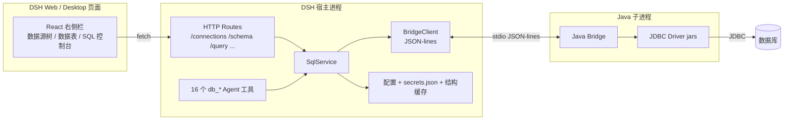
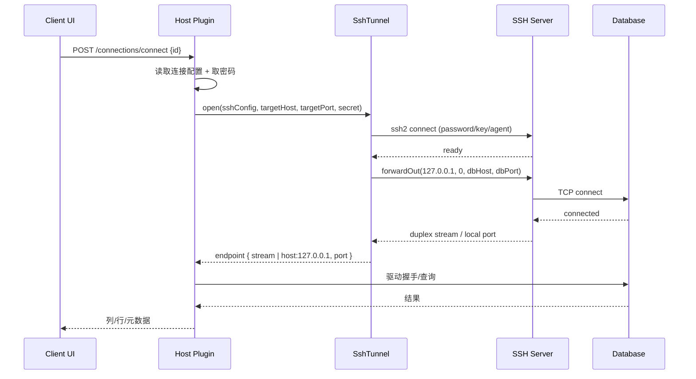
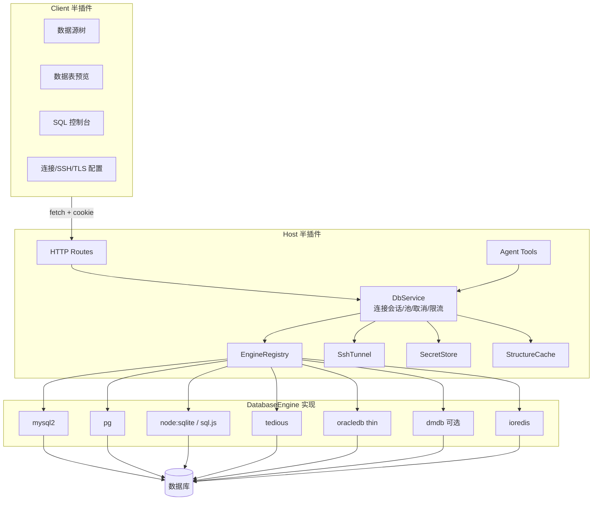

# DSH 数据库表预览插件可行性研究报告

> 版本：v1.0（调研稿）  
> 日期：2026-11-13  
> 范围：DeepSeek Harness（DSH）Web / Desktop 双半插件；数据库表预览、结构浏览、只读查询与 Agent 工具  
> 后续设计：[设计方案（B + 可选 C）](design.md)  
> 注：设计方案 v1.2 已将 SQL Server/Oracle 纳入本轮；本报告的 MVP 范围/估算以 MySQL/PostgreSQL/SQLite 为基线，实际排期见设计方案。  
> 结论：**可行**。两项限制（必须依赖 Java/JDBC、无 SSH 隧道）都有成熟替代方案；推荐用「复用现有 MIT 插件 UI + 新的 Java-free 数据访问层 + 内置 SSH 隧道」的路线，先交付 MySQL/PostgreSQL/SQLite，再补齐 SQL Server/Oracle/达梦。

## 目录

- [0. 结论摘要](#0-结论摘要)
- [1. 背景与目标](#1-背景与目标)
- [2. 现有插件拆解](#2-现有插件拆解)
- [3. DSH 插件平台可行性](#3-dsh-插件平台可行性)
- [4. Java-free 数据访问可行性](#4-java-free-数据访问可行性)
- [5. SSH 隧道可行性](#5-ssh-隧道可行性)
- [6. 推荐架构](#6-推荐架构)
- [7. 功能范围与里程碑](#7-功能范围与里程碑)
- [8. 风险与缓解](#8-风险与缓解)
- [9. 验证计划](#9-验证计划)
- [10. 结论与下一步](#10-结论与下一步)
- [附录 A：实测环境与证据](#附录-a实测环境与证据)
- [附录 B：参考资料](#附录-b参考资料)
- [附录 C：复用现有代码的许可注意事项](#附录-c复用现有代码的许可注意事项)

---

## 0. 结论摘要

| 问题 | 结论 | 主要依据 |
|---|---|---|
| 能否完全不依赖本机 Java？ | **可以**，主流数据库都有无需 Java 的 Node.js 驱动；达梦有官方 Node 驱动，但许可证限制二次分发 | 第 4 章；POC 已在 DSH 的 Electron 运行时加载 mysql2 / pg / tedious / oracledb / dmdb / ssh2 |
| 能否内置 SSH 隧道？ | **可以**，`ssh2` 的 `forwardOut` 已在 DSH Electron 运行时实测通过；MySQL 8、PostgreSQL 16 均已通过隧道完成查询与元数据读取 | 第 5 章；`poc/` 可复现脚本 |
| 能否做成 JetBrains Database 风格？ | **可以**。DSH 右侧栏有公开的 `sidebarRightTabs` / `sidebarRight` 扩展点和 `sidebar.right.pane.tab` 插槽；现有插件已证明可行 | 第 3 章；DSH `dsh-client-ui-sidebar-right` README |
| 工作量多大？ | 复用现有插件做 MVP 约 **9–12 人周**；完整对齐现有功能约 **15–20 人周**。从零做 UI 的 MVP 约 13–17 人周 | 第 7 章 |
| 最大风险是什么？ | 驱动特性/元数据 SQL 的覆盖度、TLS 穿过隧道、达梦驱动许可、DSH 客户端 API 演进 | 第 8 章 |
| 推荐路线 | **Fork `dsh-ide-database`（MIT）+ 引入 `DatabaseEngine` 抽象 + `ssh2` 隧道；纯 JS 引擎优先，JDBC 仅作为长尾数据库的可选后备** | 第 6 章 |

**一句话判断**：这不是「能不能做」的问题，而是「先覆盖哪些数据库、是否愿意维护一个 fork」的问题。技术路径已经打通，剩下的主要是工程量与测试矩阵。

| 维度 | 现有 `dsh-ide-database` | 本方案 |
|---|---|---|
| Java/JDBC | 必须（Java 8+、驱动 jar） | 默认不需要；JDBC 仅长尾可选 |
| SSH 隧道 | 不提供 | 内置（密码/私钥/agent、主机密钥校验） |
| 数据库覆盖 | 极广（任何 JDBC 驱动） | 主流库原生驱动；长尾需 Engine 或 JDBC 后备 |
| UI | 完整、成熟 | 复用/改造现有 UI |
| 主要成本 | Java 运行时与驱动运维 | 逐方言元数据、TLS/隧道适配、测试矩阵 |
| 许可 | MIT | MIT（fork）+ 达梦单独处理 |

---

## 1. 背景与目标

### 1.1 背景

[`dsh-ide-database`](https://github.com/qwq1999/dsh-ide-database) 已经实现了一个相当完整的 JetBrains Database 风格插件：右侧栏数据源树、表结构、数据表分页预览、SQL 控制台、导出、Redis、结构缓存，以及 16 个 `db_*` Agent 工具。它采用 MIT 许可证，客户端约 2.36 万行 TSX/TS，宿主约 5.8 千行 TS，Java 桥接约 1.9 千行。

它有两个明确限制：

1. **关系型数据库依赖本机 Java + JDBC 驱动**：需要 Java 8+，首次连接还要从 Maven 下载对应 JDBC jar；没有 Java 时虽然可以下载 JRE，但仍然是额外运行时、额外体积、额外启动链路。
2. **不提供 SSH 隧道**：README 的「限制」一节明确写了「不提供 SSH 隧道」。对只能通过跳板机访问的生产库，这基本等于不可用。

**调研方法**：阅读 DSH 安装包内的插件文档与 `@deepseek-ai/dsh-client-ui-sidebar-right` 源码说明；拆解现有插件的 Host/Client/Java 桥；在 DSH 的 Electron 运行时做驱动加载与 `ssh2` 转发 POC；用 Docker 起 MySQL 8、PostgreSQL 16 和 SSH 容器做端到端验证（见附录 A）。

### 1.2 目标

做一个 DSH 插件，满足：

- **Java-free**：默认路径不需要本机 Java、不需要 JDBC jar、不需要 JVM 子进程。
- **SSH 隧道内置**：支持密码/私钥/agent 认证，支持主机密钥校验，支持通过跳板机访问内网数据库。
- **JetBrains Database 风格预览**：数据源树 → Schema → 表 → 列/索引；双击表分页预览；WHERE/ORDER BY；DDL；SQL 控制台（首版只读）。
- **Agent 可查询**：提供只读的 `db_*` 工具，写操作默认关闭。
- **与 DSH 原生体验一致**：右侧栏标签页、主题 token、深浅色、快捷键、错误提示。

### 1.3 非目标（首版）

- 不做完整数据库 IDE（不追求 JetBrains 的全部功能：图形化执行计划、数据编辑/提交、整库迁移、ER 图、调试器）。
- 不承诺覆盖所有 JDBC 数据库；长尾数据库通过可选 JDBC 后备或后续插件解决。
- 不在首版做多用户/团队共享连接、云端凭据托管、审计日志。

### 1.4 术语

| 术语 | 含义 |
|---|---|
| Host 半插件 | 运行在 DSH 宿主进程（Desktop 为 Electron main）的 Node.js 插件，负责数据库连接、HTTP 路由、Agent 工具 |
| Client 半插件 | 运行在浏览器/Web 页面的 React 插件，负责右侧栏 UI |
| Engine | 本方案的数据访问抽象，一个 Engine 对应一种数据库协议/驱动 |
| Tunnel | SSH 本地端口转发层，把远端数据库映射到 `127.0.0.1:<随机端口>` 或直接提供 duplex stream |
| Java-free | 不需要用户安装 Java，也不需要 JVM 子进程；不排斥驱动包内部自带的可选原生文件（如 oracledb 的 thick 模式二进制，但默认不加载） |

---

## 2. 现有插件拆解

### 2.1 功能与规模

| 维度 | 现状 |
|---|---|
| 版本 | 0.4.0（2026-11-06 发布） |
| 许可证 | MIT |
| 客户端 | `src/client/` 约 23,623 行，React + esbuild，注册右侧栏标签页与面板 |
| 宿主 | `src/host/` 约 5,789 行，HTTP 路由、配置、密钥、结构缓存、SQL 服务、Agent 工具 |
| Java 桥 | `bridge/src/dshdb/` 约 1,871 行，JSON-lines over stdio，独立 `URLClassLoader` 加载 JDBC 驱动 |
| Agent 工具 | 16 个：连接管理、Schema/对象/表结构、DDL、SQL、EXPLAIN、Redis、驱动下载 |
| 支持数据库 | MySQL、MariaDB、PostgreSQL、SQLite、SQL Server、Oracle、达梦 DM、OceanBase（MySQL/Oracle 模式）、Redis；支持自定义 JDBC 驱动 |

> 现有插件 README 标注在 DSH `0.2.1` 上开发验证；当前环境是 `0.2.2-rc.2`，fork 后需要先做一次安装与右侧栏回归，确认没有被小版本 API 变化影响。

### 2.2 架构



关键代码位置：

- 插件入口与依赖注入：[`src/host/index.ts`](../src/host/index.ts)
- 路由注册：[`src/host/routes.ts`](../src/host/routes.ts)
- SQL 服务与 JDBC 调用：[`src/host/sql.ts`](../src/host/sql.ts)
- Java 桥客户端：[`src/host/bridge.ts`](../src/host/bridge.ts)
- Java 侧元数据/DDL/EXPLAIN：[`bridge/src/dshdb/SqlExecutor.java`](../bridge/src/dshdb/SqlExecutor.java)
- 客户端右侧栏注册：[`src/client/index.tsx`](../src/client/index.tsx)

### 2.3 两项限制的根因

**限制一：Java/JDBC**

现有实现把「协议差异」全部交给 JDBC 驱动，自己只负责：

- 维护 JDBC URL、驱动类、jar 下载与缓存；
- 起一个 JVM 桥进程；
- 通过 JSON-lines 发送 `connect / schemas / objects / describe / ddl / query / explain / transaction / cancel`；
- 用 Java 的 `ResultSetMetaData` 和 `DatabaseMetaData` 统一结果类型。

这带来的好处是数据库覆盖广、元数据实现集中；代价是必须有 JVM 和对应 JDBC jar，且 SQLite/Oracle/DM 等驱动体积、版本、TLS 配置都要用户自己处理。

**限制二：无 SSH 隧道**

现有 `SqlService.connect()` 直接把 `connection.host/port` 拼进 JDBC URL，没有「先建立 SSH 连接、再把数据库地址替换成本地端口」的层。README 也把 SSH 隧道列为明确不提供的功能。

### 2.4 可复用资产

| 资产 | 复用价值 | 备注 |
|---|---|---|
| 右侧栏 UI（树、数据表、控制台、导出、快捷键） | **极高**，从零重写至少 3–4 人周 | MIT，保留版权声明即可 |
| HTTP 路由与前端 API 约定 | 高 | 可整体保留，替换 `SqlService` 内部实现 |
| 配置/密钥/结构缓存 | 高 | 需要增加 SSH 配置与 Java-free 连接字段 |
| 16 个 Agent 工具 | 高 | 工具语义可保留，去掉「驱动下载/JDBC 参数」相关描述 |
| Java 侧元数据 SQL | 中 | 可作为逐方言移植的「参考实现」，不能直接运行 |
| 测试与 UI 验收脚本 | 中 | 可作为回归基础 |

### 2.5 结论

**不建议从零重写全部 UI。** 现有插件的客户端体量远大于宿主和 Java 桥；把精力放在「数据访问层 + SSH + 驱动适配」上，收益最高。前提是接受维护一个 fork，或把改动逐步上游化。

---

## 3. DSH 插件平台可行性

### 3.1 实测运行环境

| 项 | 值 | 来源 |
|---|---|---|
| DSH 版本 | `0.2.2-rc.2` | `DSH_INSTALL_DIR/package.json` |
| 发行形态 | Desktop（`app.asar`，profile `desktop`） | 运行时环境变量 |
| Electron | `44.7.0` | `process.versions` |
| Node.js | `24.21.0` | `process.versions` |
| Chromium | `152.0.7977.130` | `process.versions` |
| SQLite | `3.53.4`（内置） | `process.versions.sqlite` |

> 注：DSH 也有 Web（npm/源码）形态，Node 版本要求可能不同；本报告以当前 Desktop 为准，Web 形态的平台差异在 8.1 节 T6 单列风险。

### 3.2 双半插件模型

DSH 插件可以是「Host + Client」双半：

**Host 半插件**

```js
export const inject = ['webServer', 'tools']

export function apply(ctx, config) {
  // 注册 HTTP 路由：ctx.webServer.register({ kind: 'prefix', path, handler })
  // 注册 Agent 工具：ctx.tools.register(defineTool({ ... }))
  // 所有资源用 ctx.effect(() => cleanup) 管理
}
```

- 运行在宿主进程，拥有完整 Node.js 能力：`net`、`http`、`child_process`、文件系统、网络。
- 通过 `ctx.webServer` 暴露面板 API；通过 `ctx.tools` 注册 Agent 工具。
- 通过 `ctx.effect` 管理生命周期，插件卸载时清理连接、定时器、socket。
- 通过 `ctx.get('logger')` 等可选服务记录日志；可选服务不要写进 `inject`，避免在缺失它们的 profile 中无法激活。

**Client 半插件**

```js
export const inject = ['slots']

export function apply(ctx) {
  ctx.inject(['sidebarRightTabs', 'sidebarRight'], (host) => {
    host.sidebarRightTabs.register({ id, kind, title, keepMounted, multiple })
    host.slots.inject('sidebar.right.pane.tab', () => {
      host.slots.register({ name: 'sidebar.right.pane.tab', key: id }, Body)
    })
  })
}
```

- 打包成 `window.__ModuleLoader__.load({ id, factory })` 的浏览器 bundle；React 由宿主模块表提供，不要重复安装。
- 注册右侧栏标签类型、标签体、标题；通过 `sidebarRight.openTab(kind, { params })` 打开新标签。
- 使用 `--dsw-alias-*` / `--dsw-radius-*` 语义 token，自动适配深浅色。

### 3.3 关键扩展点与稳定性

| 扩展点 | 用途 | 证据 | 稳定性判断 |
|---|---|---|---|
| `ctx.webServer.register` | 面板 HTTP API | 现有插件 `src/host/index.ts`；DSH `dsh-host-webserver` README | 稳定，属于宿主公开服务 |
| `ctx.tools.register` + `defineTool` | Agent 工具 | 现有插件 `src/host/tools.ts`；`@deepseek-ai/dsh-tools` | 稳定，工具 schema 变化需跟进 |
| `ctx.sidebarRightTabs.register` | 右侧栏标签类型 | `dsh-client-ui-sidebar-right` README「Extension seats」 | **公开扩展点**，有文档和现成用例 |
| `ctx.sidebarRight.openTab` | 打开标签 | 同上 | 公开 |
| `ctx.slots.register` + `sidebar.right.pane.tab` | 标签体渲染 | 同上 | 公开 |
| `ctx.effect` / `ctx.inject` | 生命周期与可选依赖 | DSH 插件文档 | 稳定 |
| `ctx.get('credentials')` / `configEditor` | 保存密钥/配置 | DSH `configuration.md` | 可用，但凭据存储不是安全边界（见 6.8） |

**判断**：右侧栏不是「私有 DOM hack」，而是 DSH 明确暴露的扩展点；现有插件已经用同一套 API 跑通。风险主要在版本演进（字段增删），不在「能不能做」。

### 3.4 安装与分发

- 插件包是一个 npm 包，`package.json` 声明：
  - `dsh.bundle.patch`：指向 `cordis.patch.yml`，插入 Host 插件行；
  - `dsh.client`：声明客户端平台与构建产物；
  - `main` / `exports`：Host 入口；
  - `files`：发布文件清单。
- 安装：`dsh plugin --profile <profile> add <包名或本地路径>`，或在 DSH「设置 → 插件」里安装；`plugin_manager` 会调用 pnpm 安装依赖。
- Host 代码在进程启动时加载，**安装/升级后需要重启 DSH**；客户端 bundle 可能在 HMR 下热更新，但不要依赖「半加载」状态。
- 依赖构建脚本需要用户显式批准；本项目应尽量做到**零构建脚本、零原生编译**。

### 3.5 平台约束

| 约束 | 影响 | 应对 |
|---|---|---|
| Host 代码重启才生效 | 开发迭代慢 | 用独立 dev profile + 自动重启脚本；客户端用 HMR |
| 浏览器不能直接连数据库 | 必须经 Host 路由 | 所有连接/查询走 Host；Client 不持有密码 |
| Host 插件在 workspace 沙箱之外 | 拥有完整网络/文件能力，也意味着责任 | 只读默认、最小权限、审计日志、限制结果集 |
| 右侧栏按 Session 隔离 | 没有选中的 Session 时没有右侧栏；不同 Session 的布局各自保存 | 与现有插件行为一致；数据库连接放在 Host 级，不随 Session 重建 |
| 原生模块 ABI | Electron 44 与 Node 24 的 ABI 差异 | 优先纯 JS；必须原生时用 N-API 预编译并做跨平台验证 |
| DSH 版本演进 | 客户端 API 可能变 | 锁定 peer 版本；集成测试覆盖右侧栏与工具注册 |

---

## 4. Java-free 数据访问可行性

### 4.1 结论

**主流数据库可以做到 Java-free。** 关键不是「有没有驱动」，而是「驱动是否覆盖你需要的协议特性、元数据、TLS、取消、事务」。逐库看：

### 4.2 驱动矩阵

| 数据库 | Node.js 驱动 | 版本（调研时） | 是否需 Java | 许可证 | 能力/备注 | 实测状态 |
|---|---|---|---|---|---|---|
| MySQL / MariaDB | `mysql2` | 3.24.6 | 否 | MIT | 协议成熟；支持 `caching_sha2_password`、TLS、流式查询、预处理语句；需显式 `charset: 'utf8mb4'` | ✅ 通过 SSH 隧道查询、元数据、SHOW CREATE、EXPLAIN |
| PostgreSQL | `pg` | 8.23.1 | 否 | MIT | 协议成熟；支持 TLS、通知、游标；类型解析需定制 | ✅ 通过 SSH 隧道查询、information_schema、pg_indexes、EXPLAIN |
| SQLite | `node:sqlite`（内置） | Node 24 内置 | 否 | Node.js 许可证 | 同步 API；Electron 44 已验证可直接 `require('node:sqlite')`；Web 形态 Node 22 需特性检测 | ✅ 内存库建表/插入/查询 |
| SQL Server | `tedious`（或 `mssql` 包装） | 20.3.9 | 否 | MIT | 纯 JS TDS 实现；支持 TLS、`options.serverName`、请求取消；v20 要求 Node >=22 | ⏳ 未连真实实例 |
| Oracle | `oracledb`（Thin 模式） | 6.10.0 | 否 | Apache-2.0 OR UPL-1.0 | Thin 模式自 6.0 起默认，纯 JS，无需 Instant Client；要求 Oracle 12.1+；部分高级特性仅 Thick 模式支持 | ✅ 模块加载，`thin === true`；⏳ 未连真实实例 |
| 达梦 DM | `dmdb`（达梦官方） | 1.0.52452 | 否 | **商业许可证**（禁止二次分发/修改） | 包内是 JS 源码，无 `.node`；支持 DM8；但**不能随插件打包分发** | ✅ 模块加载；⏳ 未连真实实例 |
| OceanBase（MySQL 模式） | `mysql2` | 3.24.6 | 否 | MIT | 走 MySQL 协议，通常可用 | ⏳ 未实测 |
| OceanBase（Oracle 模式） | `oceanbase`（实验） | 0.0.1 | 否 | MIT | 基于 mysql2 扩展 Oracle 租户协议，版本极早期；不建议作为首版依赖 | ⏳ 未实测；建议首版不做或走 JDBC 后备 |
| Redis | `ioredis` | 5.11.1 | 否 | MIT | 现有插件已用；SSH 隧道同样适用 | ✅ 现有插件已验证纯 JS |

> 说明：`oracledb` 包内带有 thick 模式的预编译二进制，但 Thin 模式不会加载它们；这不等于「必须原生模块」。`ssh2` 也带一个可选的 `sshcrypto.node` 加速模块，加载失败会回退纯 JS。
>
> SQLite 不用 `better-sqlite3` 的原因：它是原生模块，需要匹配 Electron ABI、跨平台准备预编译包；`node:sqlite` 内置在 Node 24/Electron 44 中，安装零成本。若后续需要异步/更高并发，再评估 `better-sqlite3` 或 worker 方案。

### 4.3 已完成的运行时验证

在 DSH 的 Electron 运行时（`ELECTRON_RUN_AS_NODE=1`）中执行：

```text
mysql2   3.24.6   OK
pg       8.23.1   OK
tedious  20.3.9   OK
oracledb 6.10.0   OK (thin=true)
dmdb     1.0.52452 OK
ssh2     1.17.0   OK (forwardOut 可用)
ioredis  5.11.1   OK
node:sqlite        OK (DatabaseSync / prepare / all)
```

这说明：

- 这些包在 Electron 44 / Node 24 下可以正常 `require`；
- 不依赖 `node-gyp` 编译；
- `oracledb` 默认就是 Thin 模式；
- `dmdb` 包内没有原生二进制（`find ... -name '*.node'` 为空），确实是 JS 实现。

### 4.4 Java-free 的真实代价

「不用 Java」不等于「零成本」。JDBC 驱动帮我们做了很多事，换成 Node 驱动后需要自己补：

1. **元数据 SQL 的逐方言实现**
   - MySQL：`information_schema.tables / columns / statistics / routines / triggers`、`SHOW CREATE TABLE`、`EXPLAIN`。
   - PostgreSQL：`information_schema` + `pg_catalog`、`pg_get_viewdef`、`pg_get_triggerdef`、`EXPLAIN`。
   - SQLite：`sqlite_master`、`PRAGMA table_info / index_list / index_info / foreign_key_list`、`EXPLAIN QUERY PLAN`。
   - SQL Server：`sys.objects / columns / indexes / types`、`OBJECT_DEFINITION`、`SHOWPLAN_ALL`。
   - Oracle / 达梦：`all_tables / all_objects / all_tab_columns / all_indexes / all_constraints`、`DBMS_METADATA.GET_DDL`、`EXPLAIN PLAN FOR` + `DBMS_XPLAN`。
   - OceanBase：按 MySQL/Oracle 模式复用。
   - 现有 Java 的 `SqlExecutor.java` 是很好的「查询清单」，可以逐条移植。
2. **类型映射**
   - 数字：`BIGINT`/`DECIMAL` 不能用 JS `number`，要用字符串，避免精度丢失。
   - 日期时间：`DATETIME` 无时区，不能让驱动转成 JS `Date` 再 JSON 序列化，否则会发生时区偏移（POC 已复现：MySQL `DATETIME` 被转成 UTC ISO，字面值变了）。应配置 `dateStrings` 或自定义 type parser，返回数据库原始字面值。
   - 二进制：`BLOB`/`BYTEA`/`VARBINARY` 要截断/转十六进制或 base64，不能直接塞 JSON。
   - JSON/数组/枚举：PostgreSQL 的 `jsonb`、数组，MySQL 的 `JSON`，要决定展示为文本还是结构化。
   - NULL 与空字符串要区分。
3. **DDL 与执行计划**
   - 各库取 DDL 的方式不同；取不到时要「按结构生成」并标注来源。
   - 执行计划格式差异大；首版可以只做文本计划。
4. **取消与超时**
   - `mysql2`：销毁连接或 `KILL QUERY`。
   - `pg`：`pg_cancel_backend` / 独立连接取消，或 `statement_timeout`。
   - `tedious`：`request.cancel()`。
   - `oracledb`：`connection.break()`。
   - `dmdb`：需查文档/实测。
   - SQLite：同步查询难以中断，建议放到 `worker_threads`，用行数上限保护。
5. **TLS / 认证**
   - MySQL `caching_sha2_password`、PostgreSQL `scram-sha-256`、SQL Server NTLM/Kerberos、Oracle wallet、达梦加密方式，都要逐项验证。
   - TLS 穿过 SSH 隧道时，主机名校验会看到 `127.0.0.1`，需要驱动级 servername/checkServerIdentity 适配（见 5.5）。
6. **连接池/并发**
   - 每个连接一个池；元数据查询、表预览、Agent 查询共享池但要限制并发，避免把生产库打满。

### 4.5 JDBC 与 Java-free 对比

| 维度 | JDBC（现有） | Java-free（本方案） |
|---|---|---|
| 运行时依赖 | JVM + jar | 无 JVM；npm 包 |
| 数据库覆盖 | 极广，几乎任何有 JDBC 驱动的库 | 主流库覆盖好；长尾需自己写 Engine |
| 元数据实现 | JDBC `DatabaseMetaData` 统一 | 逐方言 SQL，工作量大但可控 |
| 安装体积 | JRE 可达数十 MB + 每库 jar | 驱动包通常几 MB；oracledb 约 4.4 MB |
| 启动/查询延迟 | 需 JVM 启动与 JSON-lines 往返 | 进程内直连，通常更低 |
| 调试 | Java 桥 + Node 两侧 | 单一 Node 进程，简单 |
| 驱动质量 | 厂商 JDBC 驱动成熟 | Node 驱动成熟度不一（达梦/OceanBase 需验证） |
| 许可 | 各 JDBC 驱动许可不同 | 各 npm 包许可不同；达梦是商业许可 |
| 维护 | Java + TS 两套 | 纯 TS/JS 一套 |

### 4.6 推荐策略：纯 JS 优先，JDBC 只做长尾后备

- **核心插件不依赖 Java**：MySQL/MariaDB、PostgreSQL、SQLite、SQL Server、Oracle、Redis 用 Node 驱动；达梦通过「用户自行安装/确认许可」的可选模块接入。
- **JDBC 作为可选插件包**：如果确实需要「任意 JDBC 数据库」或 OceanBase Oracle 模式，再提供一个独立的 `dsh-db-jdbc-bridge` 可选包；核心插件不安装它也能工作。
- 这样既满足「默认 Java-free」，又保留扩展性；不会因为一两个长尾库把整个架构拖回 JVM。

### 4.7 达梦许可风险（重要）

`dmdb` 的 LICENSE 明确写着：

- 授予的是「非排他、不可转让、不可再许可」的使用许可；
- 不得反向工程、修改、创建衍生作品；
- **不得以任何形式向第三方销售、出租、出借、转让、分发、发布、再许可或提供软件的全部或任何部分**。

这意味着：

- **不能把 `dmdb` 打进插件 npm 包**，也不能让插件安装流程默认把它作为 dependency 拉取并随插件分发；
- 可行做法是：检测到用户选择达梦时，提示许可条款，由用户**自行**在其 profile 中安装 `dmdb`，或由用户确认后从 npm 下载到本机数据目录（仍需法务确认「下载」是否构成分发）；
- 更稳妥的兜底：达梦继续走 JDBC（达梦 JDBC 驱动可从 Maven 获取），或把达梦支持做成单独的、用户自行承担许可的插件包。

这条会直接影响「是否支持达梦」的产品决策，建议在立项时就让法务确认。

---

## 5. SSH 隧道可行性

### 5.1 方案对比

| 方案 | 优点 | 缺点 | 结论 |
|---|---|---|---|
| 调用系统 `ssh -L` | 复用用户 `~/.ssh/config`、agent、known_hosts | 跨平台差异、进程管理、端口冲突、Windows 兼容性 | 可选后备，不作为主方案 |
| `ssh2`（纯 JS） | 跨平台、可编程、支持密码/私钥/agent、`forwardOut`、keepalive | 需自己做 known_hosts/主机密钥 UI | **推荐主方案** |
| 远端执行 `psql/mysql` 并解析输出 | 不用本地驱动 | 丢失协议能力、元数据/类型/取消都难做、安全面大 | 不采用 |

> DSH 源码里有一个 `@deepseek-ai/dsh-ssh`（共享 OpenSSH 连接与远程 helper），但当前 Desktop 安装包未包含它；它的公开描述面向远程执行/文件系统，未见数据库端口转发 API。因此本方案直接使用 `ssh2`，不依赖该可选包。

### 5.2 `ssh2` 能力

- 认证：password、publickey（含 passphrase）、agent、keyboard-interactive。
- 转发：`client.forwardOut(srcIP, srcPort, dstIP, dstPort, cb)` 返回 duplex stream。
- 主机密钥：`hostVerifier(key, callback)`，可计算 SHA-256 指纹并与已知指纹比对。
- 连接保活：`keepaliveInterval` / `keepaliveCount`。
- 跳板链：`Client.connect({ sock })` 可以把第二跳 SSH 建在第一跳的 stream 上（P2 可选）。
- 纯 JS 回退：包内可选 `sshcrypto.node` 只做加速，失败可回退。

### 5.3 隧道设计



两种落地方式，按驱动选择：

1. **直接 stream**：`forwardOut` 返回的 channel 直接交给驱动（适合 `mysql2`）。好处是保留原始 `host` 用于 TLS SNI；POC 已验证。
2. **本地端口转发**：在 `127.0.0.1:0` 起一个 `net.Server`，每个本地连接 `forwardOut` 到远端数据库；驱动连本地端口。适合不接受任意 duplex stream 的驱动（`pg`、`tedious`、`oracledb`、`dmdb`、Redis）。POC 已验证 MySQL/PG 走本地端口。

**生命周期**：

- 一个数据库连接对应一个 SSH 连接 + 一个隧道实例；
- 隧道按需建立，连接断开/插件卸载时关闭本地 server、所有 socket、SSH client；
- SSH 掉线时，标记连接失效，拒绝在途查询，清理池；下次操作可重连一次；
- 本地 server 只绑定 `127.0.0.1`，端口用 0 让 OS 分配，避免冲突。

### 5.4 已完成实测

| 实验 | 结果 |
|---|---|
| 进程内 SSH server + `forwardOut` 到 echo server | ✅ 往返 `echo:hello` 成功 |
| MySQL 8.0（Docker）→ SSH 容器 → 隧道 → `mysql2` | ✅ 查询 3 行（含中文）、`information_schema` 表/列/索引、`SHOW CREATE TABLE`、`EXPLAIN` 全部成功 |
| PostgreSQL 16（Docker）→ SSH 容器 → 隧道 → `pg` | ✅ 查询 3 行（含中文）、`information_schema`、`pg_indexes`、`EXPLAIN` 全部成功 |
| MySQL 走 `stream` 直连（不经本地端口） | ✅ 成功，且保留原始 `host`，有利于 TLS SNI |
| PostgreSQL 走 `stream` 直连 | ❌ `this.stream.setNoDelay is not a function`；`pg` 需要 socket 形态，改用本地端口即可 |

> 复现脚本在 [`poc/`](../poc/)，需要 Docker 与一个开启 `AllowTcpForwarding` 的 SSH 服务。

### 5.5 边界与风险

1. **TLS 主机名校验**
   - 隧道把目标变成 `127.0.0.1`，TLS 证书上的主机名对不上。
   - 解决：
     - MySQL 用 `stream` 直连，`host` 保留原值，SNI 正确；
     - SQL Server 用 `options.serverName` 指定原主机名；
     - PostgreSQL 用本地端口时，用自定义 `checkServerIdentity` 对原主机名校验证，或做一个满足 `setNoDelay/connect` 的 socket 适配器；
     - Oracle TCPS / 达梦 TLS 需逐项验证，必要时提供「跳过 DN 校验」开关并明确警告。
2. **IPv6 优先解析**
   - POC 中 SSH 容器把 `dsh-mysql` 解析成 IPv6，而 MySQL 只监听 IPv4，导致 `forwardOut` 失败；改用 IPv4 后成功。
   - 生产环境同理：如果数据库只监听 IPv4，而 sshd 优先解析到 IPv6，会连接失败。应提供「目标地址族/目标 IP」覆盖项，或在错误信息里提示。
3. **sshd 配置**
   - 很多跳板机默认 `AllowTcpForwarding no`；需要在错误信息中明确提示，而不是笼统报「连接失败」。
4. **本地端口暴露**
   - 本地 `127.0.0.1:<port>` 在隧道存续期间对本机其他进程可见。单用户桌面风险较低，但多用户主机需要注意。
   - 缓解：只绑 loopback、随机端口、空闲关闭、连接级生命周期；能走 Unix socket 的驱动优先走 Unix socket。
5. **主机密钥与 MITM**
   - 默认应 `strict` 或 `accept-new`（TOFU），首次连接展示 SHA-256 指纹并让用户确认；不要默认 `rejectUnauthorized: false`。
   - 可选解析 OpenSSH `known_hosts`（含 hashed 条目）作为 P2。
6. **Windows SSH agent**
   - Windows 的 OpenSSH agent（named pipe）与 Pageant 需要单独验证；macOS/Linux 的 `SSH_AUTH_SOCK` 路径可直接用，Windows agent 作为 P2。
7. **跳板机/代理**
   - 多跳、SOCKS、HTTP CONNECT 代理可作为 P2；首版支持单跳 + 私钥/密码/agent。
8. **网络超时**
   - SSH 连接、握手、数据库握手分别设置超时；不要让 UI 无限转圈。

### 5.6 配置模型示例

```jsonc
{
  "id": "prod-mysql",
  "name": "生产 MySQL（只读）",
  "engine": "mysql",
  "host": "10.0.12.34",
  "port": 3306,
  "database": "app",
  "user": "readonly",
  "readOnly": true,
  "ssh": {
    "enabled": true,
    "host": "bastion.example.com",
    "port": 22,
    "user": "ops",
    "auth": "key",                    // password | key | agent
    "privateKeyPath": "~/.ssh/id_ed25519",
    "hostKeyPolicy": "strict",       // strict | accept-new | insecure
    "knownHostFingerprint": "SHA256:...",
    "connectTimeoutMs": 15000,
    "keepaliveIntervalMs": 30000
  },
  "tls": {
    "enabled": true,
    "mode": "verify-full",            // disable | require | verify-ca | verify-full
    "caPath": "~/.dsh/certs/prod-ca.pem"
  }
}
```

密码、私钥 passphrase 不写在这个 JSON 里，放密钥存储（见 6.8）。

> 注意：启用 SSH 后，`host/port` 是**SSH 服务器视角**下数据库的地址，不是本机视角。若数据库只允许从跳板机访问，这里应填内网地址；`forwardOut` 由 sshd 负责解析和连接。

---

## 6. 推荐架构

### 6.1 路线对比

| 路线 | 做法 | 时间 | 优点 | 缺点 | 适用 |
|---|---|---|---|---|---|
| A. 从零新插件 | 新建 Host/Client，只做只读预览 | 13–17 人周（MVP） | 架构干净、无历史包袱、完全 Java-free | UI 工作量大；功能少；重复造轮子 | 想长期做一个独立产品 |
| B. Fork + 重构（推荐） | Fork MIT 插件，替换数据访问层，保留 UI | 9–12 人周（MVP） | 最快；UI/工具/缓存直接复用；风险可控 | 要维护 fork；要清理 JDBC 概念 | 想尽快可用、覆盖现有功能 |
| C. 混合 | 在 B 基础上保留 JDBC 可选后备 | 10–13 人周（MVP） | 兼顾长尾库；过渡平滑 | 仍保留 Java 代码路径；复杂度高 | 企业环境有大量冷门 JDBC 库 |
| D. 上游 PR | 给现有插件加 SSH + JS 引擎 | 视上游接受度 | 不回 fork；社区受益 | 受维护者节奏/方向约束；不能完全定制 | 不追求独立产品 |

> 只解决「SSH 隧道」的话，在现有 JDBC 架构上加一个本地端口转发即可，约 1–2 人周；真正的工作量在「同时去掉 Java」——需要逐方言重写元数据/DDL/执行计划，并逐个驱动验证。

### 6.2 推荐路线：B + 可选 C

**建议以 B 为主：**

1. Fork `dsh-ide-database`，保留 MIT 许可证与版权声明，改包名/插件 ID。
2. 把 `SqlService` 内部从「BridgeClient + JDBC」改为「EngineRegistry + DatabaseEngine」。
3. 新增 `SshTunnel`，在 Engine 之前解析 endpoint。
4. 先实现 MySQL/MariaDB、PostgreSQL、SQLite 三个 Engine；保留 Redis 的 `ioredis` 路径。
5. UI 保留现有树/数据表/控制台；去掉「Java 路径 / 驱动下载 / JDBC URL」等 Java 专属 UI，换成「引擎类型 / SSH / TLS」。
6. SQL Server、Oracle、达梦作为第二批 Engine；达梦按 4.7 处理许可。
7. 如果确实需要长尾 JDBC，再把 Java 桥作为**独立可选包**接回来（路线 C），核心不依赖。

**为什么不是 A**：现有客户端 2.36 万行，重写 UI 的成本远大于移植数据访问层；先做 B，等产品方向稳定后再考虑抽离/重写。

**为什么不是 D**：如果目标是「自己的插件 + 自己的发布节奏」，上游 PR 不可控；可以先给上游提 SSH 隧道 PR（对社区有价值），但自己的 Java-free 版本仍按 B 推进。

### 6.3 目标架构



### 6.4 模块划分

```text
src/
  host/
    index.ts                 // apply(ctx)，注册路由/工具
    routes.ts                // HTTP API
    db/
      service.ts             // 连接会话、池、查询、取消、限流
      registry.ts            // engine 注册与选择
      types.ts               // Engine 接口与共享类型
      engines/
        mysql.ts
        postgres.ts
        sqlite.ts
        mssql.ts
        oracle.ts
        dameng.ts
        redis.ts
      metadata/
        mysql.ts             // information_schema / SHOW CREATE / EXPLAIN
        postgres.ts
        sqlite.ts
        mssql.ts
        oracle.ts
        dameng.ts
    ssh/
      tunnel.ts              // ssh2 连接、forwardOut、本地端口
      known-hosts.ts         // 指纹/known_hosts
      auth.ts                // 密码/私钥/agent
    config/
      store.ts
      schema.ts
    secrets.ts
    structure-cache.ts
    tools.ts
  client/
    index.tsx                // 右侧栏注册
    App.tsx                  // 数据库面板
    table/                   // 数据表预览
    console/                 // SQL 控制台
    connection/              // 连接/SSH 表单
    ...
  shared/
    types.ts
    presets.ts               // 引擎预设（端口、方言、默认值）
```

### 6.5 核心接口（建议）

```ts
export type EngineKind =
  | 'mysql' | 'mariadb' | 'postgres' | 'sqlite'
  | 'mssql' | 'oracle' | 'dameng' | 'oceanbase-mysql' | 'redis'

export interface DbEndpoint {
  host: string
  port: number
  /** TLS 证书校验使用的原始主机名（隧道场景下与 host 不同） */
  tlsServername?: string
  /** 驱动直接拿 stream 时使用；没有则用 host/port */
  stream?: NodeJS.ReadWriteStream
}

export interface ConnectInput {
  endpoint: DbEndpoint
  user: string
  password: string
  database: string
  readOnly: boolean
  tls?: TlsOptions
  params: Record<string, string>
  connectTimeoutMs: number
}

export interface DatabaseEngine {
  readonly kind: EngineKind
  connect(input: ConnectInput): Promise<ServerInfo>
  disconnect(): Promise<void>
  ping(): Promise<{ ok: boolean; version?: string }>

  listSchemas(filter?: string): Promise<SchemaInfo[]>
  listObjects(schema: string): Promise<SchemaObject[]>
  describe(schema: string, table: string, kind: ObjectKind): Promise<TableDescription>
  ddl(schema: string, table: string, kind: ObjectKind): Promise<DdlResult>

  query(sql: string, options: QueryOptions): Promise<QueryResult>
  explain(sql: string): Promise<ExplainResult>
  transaction(action: 'begin' | 'commit' | 'rollback'): Promise<void>
  cancel(stmtKey: string): Promise<boolean>
}
```

`QueryOptions` 至少包含：`maxRows`、`timeoutMs`、`stmtKey`、`readOnly`、`signal`。结果统一为现有 `QueryResult`（`columns/rows/rowCount/truncated/elapsedMs/sql`），这样 UI 和 Agent 工具不用改。

### 6.6 连接与查询流程

1. Client 调 `POST /connections/connect`。
2. Host 读取连接配置，按 `secretName` 从密钥存储取密码。
3. 如果 `ssh.enabled`：
   - 建立 SSH 连接（密码/私钥/agent）；
   - 校验主机密钥；
   - 打开 `forwardOut` 或本地端口；
   - 得到 `DbEndpoint`（`host=127.0.0.1`，或 `stream`）。
4. `EngineRegistry` 按 `engine` 创建 Engine，`connect()` 握手。
5. 读取服务器版本/当前用户/当前库，缓存 `ServerInfo`。
6. 树：`/schema/list` → `/schema/objects` → `/schema/describe`；结构写入缓存。
7. 表预览：生成分页 SQL → `/query` → Engine 查询 → Host 截断/格式化 → Client 网格。
8. Agent 工具走同一个 `DbService`，只读策略在 Host 层统一执行。
9. 断开/卸载：关闭池、取消在途查询、关闭 tunnel、清理 socket。

**表预览 SQL 策略**

- 分页：MySQL/MariaDB/PostgreSQL/SQLite/达梦用 `LIMIT/OFFSET`；SQL Server 用 `OFFSET … FETCH NEXT`（必须先有 `ORDER BY`）；Oracle 12c+ 用 `OFFSET … ROWS FETCH NEXT`，老版本用 `ROWNUM`。
- 表名/列名来自结构缓存与元数据，只接受白名单标识符；WHERE/ORDER BY 的值用参数绑定或驱动转义，禁止把用户输入直接拼进 SQL。
- 不默认执行 `COUNT(*)`；用「多取一行判断是否还有下一页」，或读取统计信息/估算行数；需要总数时给用户显式按钮。
- 大字段只取截断值（如 `LEFT(col, N)`）或用单独接口按主键取完整值；单页结果设字节上限。
- 表预览默认 `readOnly`，并建议用户使用只读账号；Host 层再做一次 SQL 分类拦截。

### 6.7 配置与数据目录

- 连接配置：`<profile>/data/<plugin>/connections.json`（不含密码）。
- 密钥：优先 OS keychain（Electron `safeStorage`，需在 Host 环境验证）；否则 0600 文件 + 明确提示。
- 结构缓存：`structure.json` + 按连接分文件的描述缓存；离线可浏览。
- 日志：不记录密码、私钥、完整连接串；错误信息脱敏。
- 迁移：从现有插件导入时，保留连接名/host/port/database/user，密码需要用户重填或迁移 secret。

### 6.8 安全模型

| 边界 | 威胁 | 措施 |
|---|---|---|
| Browser → Host HTTP | 跨站请求、会话劫持 | 只接受同源 + 会话 cookie/Origin 校验；所有变更用 POST；不把密码回传 |
| Host → DB | 明文传输、证书伪造 | 默认 `verify-full`（可配置）；支持 CA；禁止默认 `rejectUnauthorized:false` |
| Host → SSH | MITM、弱主机密钥 | `strict`/`accept-new`；首次展示 SHA-256 指纹；支持 known_hosts |
| 本地隧道 | 本机其他进程连接 | 只绑 `127.0.0.1`、随机端口、空闲关闭；能走 Unix socket 优先 |
| 凭据存储 | 同用户进程读取 | OS keychain 优先；0600 兜底；不写日志；不返回 Client |
| Agent 工具 | 误写/删库 | 默认只读；写操作需显式 `allowAgentWrites` + 二次确认；危险语句拦截 |
| 查询 | 大结果/慢查询打爆宿主或生产库 | 行数/字节上限、超时、取消、并发限制、只读账号建议 |
| SQL 注入 | 表名/列名/筛选值拼接 | 标识符白名单（来自元数据）+ 值参数化/驱动转义；禁止多语句 |

**重要认知**：DSH 的 credentials 服务（`dsh-credentials-local`）是 0600 明文 YAML，明确写了「同 UID 的 Agent 进程可以读」，它不是安全边界。数据库密码要么放 OS keychain，要么接受「本机同用户可读」的风险，并在 UI 中说明。

### 6.9 与 DSH 的集成点

| 能力 | 集成方式 |
|---|---|
| 右侧栏入口 | `sidebarRightTabs.register` + `sidebar.right.pane.tab` |
| 多标签（每张表一个） | `multiple: true`，`openTab(kind, { params })` |
| 面板 API | `ctx.webServer.register({ kind: 'prefix', path, handler })` |
| Agent 工具 | `ctx.tools.register(defineTool(...))` |
| 配置 | `Config` schema 或 profile patch；运行时修改走 `configEditor` |
| 主题 | `--dsw-alias-*` token；不要硬编码颜色 |
| 国际化 | Client locale 服务 + `locale/*.json`；首版可先中文 |
| 安装 | `dsh.bundle.patch` + `dsh.client`；本地 link 安装用于开发 |

---

## 7. 功能范围与里程碑

### 7.1 MVP（建议 9–12 人周）

**连接与安全**

- 连接管理：新增/编辑/删除/测试；MySQL、PostgreSQL、SQLite 三种引擎。
- SSH：密码、私钥（含 passphrase）、agent（macOS/Linux；Windows agent 作为 P2）；主机密钥 strict/accept-new；超时/keepalive。
- 密钥存储：OS keychain 优先，0600 后备；API 不回传密码。
- 只读默认；Agent 写操作关闭。

**浏览与预览**

- 数据源树：连接 → Schema → 表/视图 → 列/索引；结构缓存与离线浏览。
- 表预览：分页（100/200/500/1000）、WHERE/ORDER BY、列类型、NULL 显示、长文本截断/查看完整值。
- DDL：服务端取不到时按结构生成并标注。
- 导出：CSV/JSON（当前页/全部，带上限）。
- SQL 控制台：只读执行、多语句、历史、取消、行数上限、耗时。
- Agent 工具：`db_list_connections`、`db_test_connection`、`db_list_schemas`、`db_list_objects`、`db_describe_table`、`db_get_ddl`、`db_execute_sql`（只读）。

**非功能**

- 单元测试 + Docker 集成测试（MySQL/PG/SQLite + SSH）。
- 基础 UI 验收（右侧栏、深浅色、键盘）。

### 7.2 P2（建议 4–6 人周）

- SQL Server、Oracle（Thin）、达梦（按许可方案）。
- Redis 走隧道，保持现有键空间浏览。
- 写操作与事务（显式开关 + 二次确认 + 只读连接拒绝）。
- 执行计划文本展示；更多方言的 DDL。
- TLS 穿过隧道的完整适配（MySQL stream、SQL Server serverName、PG checkServerIdentity、Oracle DN）。
- 连接导入/导出（不含密码）。

### 7.3 P3（按需）

- OceanBase Oracle 模式（实验驱动或 JDBC 后备）。
- 可选 JDBC 插件包，覆盖长尾数据库。
- `~/.ssh/config` 解析、多跳/ProxyJump、SOCKS。
- 数据编辑/提交、ER 图、图形化执行计划。
- 团队共享连接、审计日志。

### 7.4 工作量估算

假设：1 名熟悉 Node.js/React/DSH 插件机制的高级工程师；有可用的测试数据库；复用现有 MIT 代码；不含法务、设计、长期维护。

| 工作项 | MVP（复用 fork） | 完整对齐（复用 fork） | MVP（从零新插件） |
|---|---|---|---|
| Fork/脚手架/打包/安装 | 0.5–1 | 0.5–1 | 0.5–1 |
| Engine 抽象 + MySQL/PG/SQLite | 2.5–3 | 2.5–3 | 2.5–3 |
| SQL Server/Oracle/达梦 | — | 3–4 | — |
| 元数据/DDL/EXPLAIN 移植 | 1.5–2 | 2.5–3 | 2 |
| SSH 隧道 + 主机密钥 + 测试 | 1.5–2 | 1.5–2 | 1.5–2 |
| 连接/树/表预览/控制台 UI | 1–1.5 | 1.5–2 | 3.5–4.5 |
| Agent 工具/限流/安全 | 0.5–1 | 1–2 | 1–1.5 |
| 集成测试/CI/文档 | 1.5–2 | 2.5–3 | 2–2.5 |
| **合计（约）** | **9–12** | **15–20** | **13–17** |

> 这些是工程估算，不是承诺。实际取决于目标数据库数量、TLS/SSO/跳板复杂度、UI 还原度。

### 7.5 建议里程碑

| 里程碑 | 周期 | 交付物 | 退出条件 |
|---|---|---|---|
| M0 Spike | 1 周 | Fork 可安装；MySQL 走 SSH 隧道；表预览跑通 | 不装 Java 能连 MySQL 并看到数据 |
| M1 核心 | 2–3 周 | Engine 抽象 + MySQL/PG/SQLite + SSH + 连接 UI | 三种库的树/表预览/DDL 可用 |
| M2 体验 | 2 周 | 控制台、导出、缓存、Agent 工具、错误处理 | 日常只读预览可用 |
| M3 扩展 | 2 周 | SQL Server/Oracle/达梦（按范围） | 目标库矩阵通过 |
| M4 硬化 | 1–2 周 | 安全、性能、打包、文档 | 验收清单通过 |

---

## 8. 风险与缓解

### 8.1 技术风险

| # | 风险 | 影响 | 可能性 | 缓解 |
|---|---|---|---|---|
| T1 | 驱动特性不足（Oracle Thin 高级特性、达梦元数据、OceanBase Oracle） | 高 | 中 | 先做 POC；明确支持矩阵；长尾走 JDBC 可选包 |
| T2 | TLS 穿隧道主机名校验失败 | 高 | 高 | 按驱动做 servername/checkServerIdentity/stream 适配；集成测试覆盖 TLS |
| T3 | 元数据 SQL 移植遗漏/方言差异 | 中 | 高 | 以现有 Java `SqlExecutor` 为清单；逐库测试；缓存 + 降级 |
| T4 | 大结果集/长文本导致宿主内存或 UI 卡死 | 高 | 中 | 行数/字节上限；流式导出；SQLite 放 worker；单元格截断 |
| T5 | 取消/超时实现不一致 | 中 | 中 | 每驱动实现 cancel；统一 `AbortSignal`；兜底断开连接 |
| T6 | `node:sqlite` 在较旧 Node 22（<22.13）或未启用实验特性时不可用 | 中 | 中 | 特性检测；回退 `sql.js`/`node-sqlite3-wasm`；文档要求 Node >=22.13 |
| T7 | 原生模块 ABI（ssh2 可选加速、oracledb thick） | 中 | 低 | 不启用 thick；ssh2 失败回退纯 JS；跨平台安装测试 |
| T8 | DSH 客户端 API 演进 | 高 | 中 | 锁定版本；集成测试；关注 `sidebarRightTabs` 变更；保留降级入口 |

### 8.2 安全风险

| # | 风险 | 影响 | 可能性 | 缓解 |
|---|---|---|---|---|
| S1 | SSH 主机密钥未校验，遭 MITM | 高 | 中 | 默认 strict/accept-new；首次展示指纹；禁止默认 insecure |
| S2 | 本地隧道端口被同机进程滥用 | 中 | 低 | 只绑 loopback、随机端口、空闲关闭；Unix socket 优先 |
| S3 | 密码/私钥泄露到日志/API/前端 | 高 | 中 | 密钥存储；日志脱敏；API 只返回 `hasPassword`；不把密码传 Client |
| S4 | Agent 误执行写操作/危险 SQL | 高 | 中 | 默认只读；写开关 + 二次确认；只读账号；危险语句黑名单 |
| S5 | 跨站请求伪造面板 API | 高 | 中 | 同源 + cookie/Origin 校验；POST-only；不返回敏感数据 |
| S6 | 同 UID 进程读取凭据 | 中 | 高 | OS keychain；UI 说明风险；不宣称「加密安全」 |

### 8.3 法律/许可风险

| # | 风险 | 影响 | 可能性 | 缓解 |
|---|---|---|---|---|
| L1 | 达梦 `dmdb` 禁止二次分发 | 高 | 高 | 不打包；用户自行安装/确认；或达梦走 JDBC；法务确认 |
| L2 | Fork MIT 代码未保留版权声明 | 中 | 低 | 保留 LICENSE、版权头、NOTICE；README 注明来源 |
| L3 | 驱动许可证（oracledb、OceanBase、JDBC jar） | 中 | 低 | 逐包审查；不默认打包有疑问的驱动 |
| L4 | Oracle/SQL Server 数据库授权 | 中 | 低 | 用户自有授权；插件不提供数据库本体 |

### 8.4 产品/维护风险

| # | 风险 | 影响 | 可能性 | 缓解 |
|---|---|---|---|---|
| P1 | Fork 与上游分叉，修 bug 成本高 | 中 | 高 | 只改数据访问层，UI 尽量少动；定期 rebase；把通用改进上游化 |
| P2 | 功能范围膨胀，MVP 延期 | 中 | 高 | 首版严格只读；SQL Server/Oracle/达梦放 P2；不做数据编辑 |
| P3 | 用户期望「像 JetBrains 一样全功能」 | 中 | 中 | 在 README/详情页写清支持矩阵与限制 |
| P4 | 测试数据库难获取（Oracle/DM） | 中 | 中 | Docker/云上临时实例；先用 MySQL/PG 做主干；DM 需 license |

---

## 9. 验证计划

### 9.1 单元测试

- SQL 只读分类：`SELECT/WITH/SHOW/DESCRIBE/EXPLAIN` 放行；`INSERT/UPDATE/DELETE/DDL` 拒绝；`SELECT ... INTO OUTFILE`、`COPY ... TO PROGRAM` 拒绝。
- 标识符引用与字面量转义：MySQL 反引号、PostgreSQL 双引号、SQL Server 方括号、Oracle 双引号。
- 类型格式化：BIGINT/DECIMAL 保精度、DATETIME 不偏移、BLOB 截断、NULL 保留。
- SSH 配置校验：必填项、私钥路径、超时范围、host key policy。
- known_hosts/指纹匹配：匹配、不匹配、未知。
- 分页 SQL：各方言 LIMIT/OFFSET vs OFFSET FETCH；ORDER BY 必填场景。
- 结果截断：行数上限、字节上限、单元格上限。

### 9.2 集成测试矩阵

| 数据库 | 镜像 | 测试内容 |
|---|---|---|
| MySQL 8.0 | `mysql:8.0` | 连接、查询、中文、元数据、SHOW CREATE、EXPLAIN、事务、取消 |
| MariaDB 11 | `mariadb:11` | 同 MySQL，检查兼容性 |
| PostgreSQL 16 | `postgres:16-alpine` | 连接、查询、中文、information_schema、pg_indexes、EXPLAIN、事务、取消 |
| SQLite | 文件/内存 | 建表、查询、PRAGMA、EXPLAIN QUERY PLAN、大文本 |
| SQL Server 2022 | `mcr.microsoft.com/mssql/server:2022-latest` | 连接、TLS、元数据、SHOWPLAN、取消（如资源允许） |
| Oracle 23ai Free | `container-registry.oracle.com/database/free` | Thin 连接、元数据、DBMS_METADATA、EXPLAIN PLAN（如资源允许） |
| 达梦 DM8 | 官方镜像/授权环境 | 连接、元数据、DDL、EXPLAIN；许可确认 |
| Redis 7 | `redis:7-alpine` | 经隧道的 SCAN/GET/命令 |
| SSH | `linuxserver/openssh-server` 或自建 | 密码/私钥/agent、`AllowTcpForwarding`、host key 变更、断线重连 |

### 9.3 端到端（E2E）

- 在独立 dev profile 安装插件，**确认机器上没有 Java**，创建 MySQL/PG 连接（经 SSH），打开右侧栏，展开树，双击表预览，执行只读 SQL。
- Agent 会话调用 `db_list_schemas` / `db_execute_sql`，验证只读策略。
- 深浅色、窄窗口、多标签、关闭/重开、离线缓存。
- 升级 DSH 版本后回归右侧栏注册与工具注册。

### 9.4 性能

- 100 万行表分页：首屏 < 1s（不含网络），翻页稳定；不执行无上限 `COUNT(*)`。
- 50 MB 文本字段：列表只取截断值，查看完整值有上限/确认。
- 20 个并发查询：连接池/队列不崩；取消生效。
- 内存：单次查询结果字节上限（如 8 MB）；导出流式写入，不整包进内存。

### 9.5 安全验收

- 错误密码、错误私钥、主机密钥不匹配、`AllowTcpForwarding no` 的错误信息准确且不泄露敏感信息。
- 面板 API 跨站请求被拒；未登录请求被拒。
- 只读连接执行写 SQL 被 Host 拒绝；Agent 写开关关闭时拒绝。
- 日志中搜索不到密码/私钥/passphrase。
- 关闭插件后无残留 socket/定时器/子进程。

### 9.6 验收标准（MVP）

- [ ] 不安装 Java 的情况下，能通过 SSH 隧道连接 MySQL 8 和 PostgreSQL 16。
- [ ] 能浏览 Schema/表/列/索引，能分页预览表数据，能看 DDL。
- [ ] 能执行只读 SQL，结果有行数/耗时/截断提示。
- [ ] Agent 能列出连接、列出 Schema、描述表、执行只读查询。
- [ ] 连接密码不出现在 HTTP 响应、日志、前端存储中。
- [ ] SSH 主机密钥变更时连接被拒绝，并给出明确提示。
- [ ] 卸载插件后无残留连接/进程。

---

## 10. 结论与下一步

### 10.1 结论

**结论：Go（有条件）。** 条件如下：

1. **技术可行**：Java-free 驱动 + `ssh2` 隧道 + DSH 右侧栏扩展点，三条链路都已验证或已有明确实现路径。
2. **产品可行**：现有插件的 UI/工具/缓存可以直接复用；MVP 不需要从零造 UI。
3. **主要不确定性不在「能不能」，而在「覆盖多少库、测试多深、达梦许可怎么处理」**。
4. **建议立项**，按「Fork + Engine 抽象 + 纯 JS 优先 + JDBC 可选」推进；首版严格只读，先把 MySQL/PostgreSQL/SQLite + SSH 做扎实。

### 10.2 建议的 2 周 Spike

| 天 | 任务 | 产出 |
|---|---|---|
| D1–D2 | Fork、改包名/插件 ID、跑通安装与右侧栏 | 能在 dev profile 打开数据库面板 |
| D3–D5 | 引入 `DatabaseEngine`，实现 MySQL Engine + SSH 隧道 | 不装 Java 连接 MySQL，树/表预览可用 |
| D6–D7 | 移植 MySQL 元数据/DDL/EXPLAIN；接入现有 UI | 结构、DDL、执行计划可用 |
| D8 | 实现 PostgreSQL Engine，验证隧道与类型 | 两种库跑通 |
| D9 | 只读策略、限流、错误处理 | 安全基线 |
| D10 | 验收、记录问题、估算剩余工作 | Go/No-Go 决策 |

**Spike 的 Go 条件**：

- 不装 Java 能连 MySQL/PG；
- SSH 密码/私钥至少一种可用；
- 表预览、DDL、只读 SQL 可用；
- 现有 UI 不需要大改；
- 没有遇到阻塞性的 DSH API 问题。

### 10.3 需要尽早确认的决策

1. **目标数据库优先级**：只做 MySQL/PG/SQLite，还是首版就包含 SQL Server/Oracle/达梦？
2. **是否接受维护 fork**：还是愿意先给上游提 PR、再决定是否独立？
3. **达梦策略**：不做 / 用户自行安装 `dmdb` / 走 JDBC / 单独插件包？需要法务确认。
4. **凭据存储**：OS keychain 是否在目标 DSH 发行形态可用？不可用时是否接受 0600 文件？
5. **写操作**：首版是否完全不开放写？如果开放，审计与确认流程要做到什么程度？

---

## 附录 A：实测环境与证据

### A.1 环境

```text
DSH:      0.2.2-rc.2
Desktop:  /Applications/DeepSeek Harness.app
Electron: 44.7.0
Node:     24.21.0
OS:       macOS (Apple Silicon)
```

### A.2 依赖加载

在 DSH 的 Electron 运行时中执行：

```bash
ELECTRON_RUN_AS_NODE=1 "/Applications/DeepSeek Harness.app/Contents/MacOS/DeepSeek Harness" -e '
for (const p of ["mysql2","pg","tedious","oracledb","dmdb","ssh2","ioredis"]) {
  try { const m=require(p); console.log(p, "OK", m.version || require(p+"/package.json").version) }
  catch(e){ console.log(p, "FAIL", e.message) }
}'
```

结果：全部 `OK`；`oracledb.thin === true`；`dmdb` 包内无 `.node`。

### A.3 `node:sqlite`

```js
const { DatabaseSync } = require('node:sqlite')
const db = new DatabaseSync(':memory:')
db.exec('create table t(a int)')
db.prepare('insert into t values (?)').run(1)
console.log(db.prepare('select * from t').all())
```

结果：`[ { a: 1 } ]`。

### A.4 SSH 隧道 + MySQL 8

- 拓扑：宿主机 → `dsh-ssh`（宿主 `12222` → 容器 `2222`）→ Docker 网络 → `dsh-mysql:3306`。
- 结果：3 行数据（含中文）、`information_schema.tables/columns/statistics`、`SHOW CREATE TABLE`、`EXPLAIN` 全部成功。
- 注意：SSH 容器默认 `AllowTcpForwarding no`，需改为 `yes`；目标主机被解析为 IPv6 而 MySQL 只监听 IPv4 时会失败，改用 IPv4 后成功。

### A.5 SSH 隧道 + PostgreSQL 16

- 拓扑：宿主机 → `dsh-ssh` → Docker 网络 → `dsh-pg:5432`。
- 结果：3 行数据（含中文）、`information_schema.tables/columns`、`pg_indexes`、`EXPLAIN` 全部成功。
- `pg` 直接吃 `ssh2` channel 会报 `setNoDelay is not a function`；改用本地端口转发成功。

### A.6 未验证项

- SQL Server、Oracle、达梦、OceanBase 的真实连接与元数据。
- TLS 穿过隧道（MySQL/PG/SQL Server/Oracle）。
- 主机密钥 strict/known_hosts 的完整 UI 流程。
- DSH 插件实际安装与右侧栏 UI 联调（本报告只验证了平台 API 与数据链路）。
- Web 形态（非 Desktop）下的 `node:sqlite` 与插件安装。

> 这些是实施阶段第一优先级要补的实验，不应被「模块能加载」替代。

---

## 附录 B：参考资料

- 现有插件：[qwq1999/dsh-ide-database](https://github.com/qwq1999/dsh-ide-database)
- DSH 右侧栏扩展点：`@deepseek-ai/dsh-client-ui-sidebar-right` README（本机安装包内）
- DSH 插件开发文档：`dsh-doc` skill references（`plugin-development.md`、`host-plugin.md`、`ui-plugin.md`、`configuration.md`）
- node-oracledb Thin/Thick 模式：[Appendix A](https://node-oracledb.readthedocs.io/en/stable/user_guide/appendix_a.html)
- node-oracledb 安装说明：[Installing node-oracledb](https://node-oracledb.readthedocs.io/en/v6.8.0/user_guide/installation.html)
- 达梦 Node.js 驱动文档：[DM Node.js 编程指南](https://eco.dameng.com/document/dm/zh-cn/pm/nodejs-rogramming-guide.html)
- 达梦 npm 包：[dmdb](https://www.npmjs.com/package/dmdb)
- ssh2：[mscdex/ssh2](https://github.com/mscdex/ssh2)
- tedious：[tediousjs/tedious](https://github.com/tediousjs/tedious)
- mysql2：[sidorares/node-mysql2](https://github.com/sidorares/node-mysql2)
- node-postgres：[node-postgres](https://node-postgres.com/)
- Node.js `node:sqlite`：[Node.js SQLite 文档](https://nodejs.org/api/sqlite.html)
- OceanBase Node 驱动：[oceanbase](https://www.npmjs.com/package/oceanbase)（0.0.1，实验性）

---

## 附录 C：复用现有代码的许可注意事项

如果 Fork `dsh-ide-database`：

- 保留原 `LICENSE`（MIT）与版权声明；
- 在 README/详情页注明「基于 qwq1999/dsh-ide-database」；
- 修改过的文件保留原版权头（如有）；
- 不要移除原仓库的 MIT 声明；
- 如果后续把改进提交回上游，遵循上游的贡献规范。

MIT 允许商用、修改、再分发，但要求保留版权声明和许可声明。达梦 `dmdb` 不适用 MIT，按第 4.7 节单独处理。
